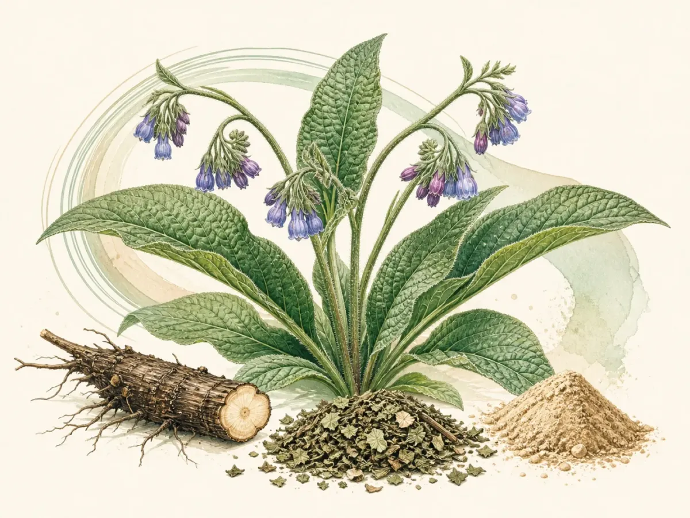

Bol u kolenu sa unutrašnje strane najčešće dolazi od povrede unutrašnjeg bočnog ligamenta (MCL), oštećenja meniskusa, artroze ili upale sluzne kesice. Ako je bol počeo posle udarca ili uvrtanja, verovatnija je povreda. Ako se razvijao polako i jači je posle hoda i stepenica, češće je u pitanju artroza.

> Tekst je informativnog karaktera i ne zamenjuje savet lekara ili farmaceuta.

U nastavku su mogući uzroci, znaci po kojima se razlikuju, šta možete da uradite kod kuće i kada je potreban pregled.

## Bol u kolenu sa unutrašnje strane: mogući uzroci

Američka nacionalna medicinska biblioteka ([MedlinePlus](https://medlineplus.gov/ency/article/003187.htm)) navodi desetak uzroka bola u kolenu. Za unutrašnju stranu najvažniji su ovi:

| Uzrok | Kako obično počinje | Tipični znaci |
|---|---|---|
| Povreda unutrašnjeg bočnog ligamenta (MCL) | jak udarac u koleno ili uvrtanje, često u sportu | „pucanj“ u trenutku povrede, otok, bol duž unutrašnje strane, nestabilnost |
| Oštećenje meniskusa | povreda kolena (pocepan meniskus) | bol sa unutrašnje ili spoljne strane zglobne linije |
| Artroza (osteoartritis) | postepeno, obično od srednjih godina | bol jači posle aktivnosti, jutarnja ukočenost do 30 minuta, krckanje |
| Burzitis (upala sluzne kesice) | ponovljen pritisak, dugo klečanje, preopterećenje ili udarac | bol na mestu upale |

MedlinePlus među uzrocima navodi i upalu tetive (tendinitis), istegnuće i uganuće. Druge uzroke, kao što su infekcija zgloba, giht ili reumatoidni artritis, prepoznaje lekar. Zato bol koji ne prolazi ili prati groznica treba pregledati.

## Ligamenti, meniskus i otok posle povrede

Unutrašnji bočni ligament (MCL) ide duž unutrašnje strane kolena i drži zglob stabilnim. Prema [MedlinePlus-u](https://medlineplus.gov/ency/patientinstructions/000671.htm), povreda nastaje kod jakog udarca u koleno ili uvrtanja. Češća je kod skijaša i igrača fudbala i košarke, gde su nagla zaustavljanja i promene pravca.

Tipični znaci povrede ligamenta su:

- glasan „pucanj“ u trenutku povrede,
- bol u kolenu i otok sa unutrašnje strane,
- osećaj da koleno „beži“ u stranu,
- zaključavanje ili zapinjanje pri pokretu.

Ligament može da bude delimično ili potpuno pocepan. Lekar procenjuje povredu pregledom, a po potrebi i rendgenom ili magnetnom rezonancom. MedlinePlus navodi da većini ljudi sa povredom MCL-a nije potrebna operacija. Koriste se mirovanje, štake, steznik i fizikalna terapija.

Kod meniskusa bol se oseća sa unutrašnje ili spoljne strane zglobne linije. Ako koleno zaključava, škljoca ili popušta pod vama, to je razlog za pregled, a ne za čekanje.

## Bol pri hodanju i savijanju: da li je artroza

Ako koleno boli pri hodanju, na stepenicama i pri savijanju, a bol se razvijao mesecima, čest uzrok je artroza. To je najčešća bolest zglobova. Prema MedlinePlus-u, simptomi se obično javljaju od srednjih godina, a do 70. godine skoro svi imaju neke znake artroze.

Tipično za artrozu:

- bol jači posle aktivnosti i opterećenja, a blaži uz odmor,
- jutarnja ukočenost koja obično traje do 30 minuta,
- krckanje ili trenje pri pokretu,
- otok posle većeg opterećenja.

Američki institut NIAMS među faktorima rizika navodi godine, višak kilograma, raniju povredu ili operaciju zgloba, ponavljane pokrete i porodičnu sklonost. Žene su posle 50. godine sklonije artrozi od muškaraca. Za dijagnozu ne postoji jedan test: lekar se oslanja na pregled, a po potrebi na snimak.

## Šta raditi kod kuće prvih dana

Kod blažeg bola, bez znakova za hitan pregled, MedlinePlus savetuje sledeće korake:

1. **Mirovanje.** Izbegavajte aktivnosti koje izazivaju bol i ne opterećujte koleno.
2. **Led.** Prvog dana stavljajte led na svaki sat, najviše 15 minuta. Posle toga bar četiri puta dnevno. Led uvek umotajte u tkaninu.
3. **Kompresija.** Nosite elastični zavoj ili elastičnu navlaku za koleno.
4. **Podizanje noge.** Držite koleno podignuto što više, da bi otok splasnuo.
5. **Lekovi protiv bola.** Ibuprofen ili naproksen ublažavaju bol i otok, a paracetamol samo bol. Pitajte farmaceuta da li vam odgovaraju, posebno ako imate hronične bolesti ili pijete druge lekove.
6. **Telesna težina.** Ako imate višak kilograma, svaki kilogram više dodatno opterećuje koleno na stepenicama.

Ako bol posle tri dana nege kod kuće i dalje traje, javite se lekaru.

## Šta kažu dokazi: vežbe, lekovi i kreme

**Vežbe.** Cochrane pregled iz 2024. godine obuhvatio je 139 studija sa 12.468 ispitanika sa artrozom kolena. [Vežbanje](https://www.cochrane.org/evidence/CD004376_exercise-osteoarthritis-knee) je u poređenju sa izostankom terapije verovatno popravilo funkciju kolena i moglo je da smanji bol. Autori ocenjuju da su dokazi niske do umerene pouzdanosti i da klinički značaj te koristi nije sasvim jasan. NIAMS i MedlinePlus ipak navode vežbe i održavanje telesne težine kao deo lečenja artroze.

**Fizikalna terapija.** MedlinePlus navodi da ona pomaže da se vrati snaga mišića posle povrede ligamenta. Kod artroze, ako posle 6 do 12 nedelja nema pomaka, verovatno neće ni pomoći.

### Lek za bol u kolenu sa unutrašnje strane

Za kratkotrajni bol koriste se lekovi iz apoteke, a kod artroze lekar može da predloži i druge lekove ili injekcije. Paracetamol se ne uzima više od 4 grama dnevno. MedlinePlus navodi da artroza ne prolazi trajno, ali da se simptomi mogu držati pod kontrolom.

Nijedna krema, gel ni dodatak ishrani ne obnavlja hrskavicu. Kreme mogu da budu dodatak vežbama, a ne zamena. Vrste krema i gelova i dokaze za njih detaljno smo uporedili u vodiču [krema za zglobove i bol u kolenu](/vodici/krema-za-zglobove/).

## Gelovi sa gavezom: kako ih uporediti

Gavez (*Symphytum officinale*) je biljka koja se tradicionalno koristi na koži. Evropska agencija za lekove ([EMA](https://www.ema.europa.eu/en/medicines/herbal/symphyti-radix)) je ocenila da se preparati od korena gaveza, na osnovu duge upotrebe, mogu koristiti za ublažavanje simptoma manjih uganuća i modrica. Upotreba je samo na koži, samo kod odraslih i ne duže od 10 dana.

Bol od artroze i pocepan ligament nisu na toj listi. Gel sa gavezom zato ima smisla posle blagog udarca ili uganuća, a ne kao terapija za artrozu.

Na našem sajtu detaljno opisujemo dva gela iz kategorije [zglobovi i bolovi](/zglobovi-i-bolovi/):

- [Nautubone](/zglobovi-i-bolovi/nautubone/) sadrži ekstrakt korena gaveza, ulja geranijuma i muskatne žalfije i ekstrakt cveta rimske kamilice.
- [BoneControl](/zglobovi-i-bolovi/bonecontrol/) ima sličan sastav: ekstrakt korena gaveza, ulja geranijuma, muskatne žalfije i rimske kamilice i vitamin E (tokoferol).

Pre kupovine uporedite tačan sastav sa deklaracije, upozorenja i podatke o proizvođaču. Nijedan gel ne zamenjuje pregled kada postoje znaci ozbiljne povrede.

### Kome gelovi sa gavezom nisu namenjeni

- **Deca**, jer EMA gavez predviđa samo za odrasle.
- **Oštećena koža.** Ne nanosite gel na rane, ogrebotine i iritiranu kožu.
- **Dugotrajna upotreba.** Gavez sadrži pirolizidinske alkaloide, koji uneti na usta oštećuju jetru. Kratka upotreba na koži, prema EMA, nije značajan rizik, ali ne koristite ga duže od 10 dana.
- **Alergija** na neki od sastojaka, uključujući eterična ulja i kamilicu.
- **Trudnice i dojilje** neka se prethodno posavetuju sa lekarom.

## Kada lekaru

Prema MedlinePlus-u, javite se lekaru ako:

- ne možete da stanete na nogu,
- imate jak bol čak i kada ne opterećujete koleno,
- koleno popušta, škljoca ili se zaključava,
- koleno je deformisano ili ga ne možete savijati ni potpuno ispraviti,
- imate groznicu, crvenilo ili toplotu oko kolena ili jak otok,
- imate bol, otok, utrnulost, trnce ili plavu prebojenost lista ispod bolnog kolena,
- bol traje i posle tri dana nege kod kuće.

Hitno se javite ako posle povrede izgubite osećaj u stopalu ili vam stopalo postane hladno ili promeni boju.
