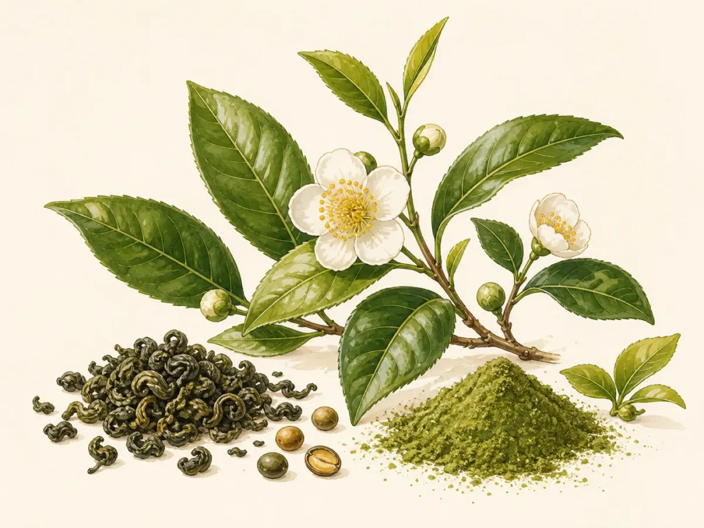

Čaj za mršavljenje sam po sebi ne topi masti i nema dokaza da donosi primetan gubitak težine. Zeleni čaj, najčešći sastojak, u Cochrane pregledu studija nije doveo do gubitka težine koji ima klinički značaj. Mnoge mešavine sadrže i senu i krušinu, a to su laksativi koje Evropska agencija za lekove (EMA) ocenjuje samo za kratkotrajnu upotrebu kod povremenog zatvora.

> Tekst je informativnog karaktera i ne zamenjuje savet lekara ili farmaceuta.

Čajevi „za mršavljenje“ prodaju se u apotekama, prodavnicama zdrave hrane i preko interneta. Na pakovanju često piše „detoks“, „ravan stomak“ ili „brže sagorevanje“. Ispod je pregled onoga što se u tim mešavinama najčešće nalazi i šta o tim biljkama kažu nezavisni izvori.

## Čaj za mršavljenje: sastav i šta koja biljka radi

Većina ovih čajeva spada u dve grupe. Prvu čine mešavine sa zelenim čajem. Drugu čine mešavine sa biljkama za creva, kao što su sena i krušina. Pre kupovine pogledajte deklaraciju i proverite u koju grupu čaj spada.

| Sastojak | Šta kažu izvori | Na šta paziti |
|---|---|---|
| Zeleni čaj | Cochrane: gubitak težine vrlo mali i bez kliničkog značaja | sadrži kofein |
| List sene | EMA: kratkotrajno kod povremenog zatvora | najduže nedelju dana, ne pre 12. godine |
| Kora krušine | EMA: kratkotrajno kod povremenog zatvora | najduže nedelju dana, ne u trudnoći i dojenju |
| Matičnjak, nana, kopriva, list masline | u izvorima koje smo pregledali nema potvrde za mršavljenje | proverite upozorenja na pakovanju |
| Komorač, kim, kleka, kamilica | u izvorima koje smo pregledali nema potvrde za mršavljenje | česti su u mešavinama sa senom |

Ni za jednu biljku iz tabele EMA ne navodi mršavljenje kao namenu. Američki Nacionalni centar za komplementarno i integrativno zdravlje (NCCIH) navodi da nauka ne podržava upotrebu dodataka sa zelenim čajem za mršavljenje.

## Šta kažu dokazi: da li čaj za mršavljenje deluje

### Zeleni čaj

Zeleni čaj je najbolje proučen sastojak ovih mešavina. [Cochrane pregled](https://www.cochrane.org/evidence/CD008650_green-tea-weight-loss-and-weight-maintenance-overweight-or-obese-adults) obuhvatio je 15 studija o mršavljenju i 3 studije o održavanju težine. Učestvovalo je ukupno 1.945 odraslih sa prekomernom težinom ili gojaznošću, a studije su trajale 12 do 13 nedelja.

U šest studija rađenih van Japana, sa 532 učesnika, razlika u odnosu na kontrolnu grupu iznosila je svega 0,04 kg. Autori zaključuju da je taj gubitak statistički neznačajan, vrlo mali i verovatno bez kliničkog značaja. Zeleni čaj nije pomogao ni da se izgubljena težina održi.

Neželjena dejstva u studijama, kao što su mučnina, zatvor, nelagodnost u stomaku i porast krvnog pritiska, uglavnom su bila blaga do umerena.

### Sena i krušina: laksativi, a ne sredstvo za mršavljenje

List sene i kora krušine su biljni laksativi. [EMA](https://www.ema.europa.eu/en/medicines/herbal/sennae-folium) je za obe biljke zaključila isto: mogu da se koriste kratkotrajno kod povremenog zatvora. To je ocena „dobro utvrđene upotrebe“, zasnovana na dugogodišnjem korišćenju u Evropskoj uniji.

Ograničenja su jasna:

1. **Samo za odrasle i adolescente starije od 12 godina.**
2. **Najduže nedelju dana.** Za senu EMA navodi da se obično uzima dva do tri puta nedeljno.
3. **Dužu upotrebu treba izbegavati.** Prema EMA, duža upotreba može da poremeti ravnotežu vode i soli u telu i da promeni boju sluznice creva.
4. **Ako tegobe traju ili se pogoršaju**, potrebno je javiti se lekaru ili farmaceutu.

EMA navodi i da mokraća posle ovih biljaka može da postane žuta ili crvenkastosmeđa, što nije štetno. Mršavljenje se u ovim ocenama nigde ne pominje. Laksativ deluje na pražnjenje creva, pa lakši osećaj posle ovakvog čaja ne treba mešati sa mršavljenjem. Laksativi nisu sredstvo za mršavljenje.

### Šta NCCIH kaže o dodacima za mršavljenje

[NCCIH](https://www.nccih.nih.gov/health/tips/tips-know-the-facts-about-supplements-marketed-for-weight-loss) daje nekoliko upozorenja koja važe i za čajeve:

- Budite oprezni sa obećanjima koja zvuče predobro da bi bila tačna, kao i sa svedočenjima kupaca.
- Američka agencija FDA pronašla je proizvode za mršavljenje, prodavane kao dodaci ishrani, sa skrivenim lekovima na recept ili drugim nedozvoljenim sastojcima.
- Mnogi dodaci za mršavljenje, uključujući „sagorevače masti“ i proizvode za smanjenje apetita, nisu ispitani na bezbednost.
- Neki proizvodi sadrže velike količine kofeina ili guarane, što može da ubrza rad srca i izazove poremećaj srčanog ritma.
- Pre uzimanja bilo kog dodatka za mršavljenje razgovarajte sa lekarom.

## Koji je najbolji čaj za mršavljenje?

Prema dostupnim dokazima, nijedan čaj nije pokazao značajan efekat na težinu, pa ne postoji ni „najbolji“. Ako ipak želite da pijete biljni čaj, izaberite ga pažljivo:

1. **Pročitajte sastav.** Ako među sastojcima vidite senu (*Cassia senna*) ili krušinu (*Rhamnus frangula*), to je čaj za creva, a ne za mršavljenje.
2. **Proverite kofein.** Zeleni čaj prirodno sadrži kofein. Ako uz to pijete i kafu, ukupna količina može da bude velika.
3. **Ne verujte obećanjima o kilogramima.** Proizvod koji obećava tačan broj kilograma za određeno vreme ne oslanja se na dokaze.
4. **Proverite proizvođača i deklaraciju.** Na pakovanju treba da piše ko proizvodi čaj, koliki je neto sadržaj i kako se priprema.
5. **Razgovarajte sa lekarom** ako pijete lekove ili imate hroničnu bolest.

Kada je reč o mršavljenju, čaj može da bude samo prijatan napitak. Plan za promenu težine napravite sa izabranim lekarom ili nutricionistom.

## Gotovi čajevi iz kataloga: kako ih uporediti

U katalogu se nalaze dve vrste biljnih mešavina koje se prodaju za mršavljenje:

- [Go Slim](/ponude/rs/goslim/) i [Easy Slim](/ponude/rs/easy-slim/) imaju isti sastav prema deklaraciji: plod komorača, plod kima, plod kleke, cvet kamilice, list sene i koru krušine. Zbog sene i krušine to su mešavine za creva. Važe ista ograničenja kao za ove dve biljke: kratkotrajno, najduže nedelju dana, ne pre 12. godine, ne u trudnoći i dojenju.
- [Keto Tea](/ponude/rs/keto-tea/) i [Apolloss](/ponude/rs/apolloss/) takođe imaju međusobno isti sastav: list zelenog čaja, matičnjaka, koprive, nane i masline. Ne sadrže laksativne biljke, ali sadrže kofein iz zelenog čaja. Prema Cochrane pregledu, od zelenog čaja ne treba očekivati gubitak težine koji ima klinički značaj.

Ostale proizvode, uključujući kapsule sa ekstraktom zelenog čaja, nađite u kategoriji [mršavljenje i metabolizam](/mrsavljenje-i-metabolizam/). Pre kupovine uporedite tačan sastav, upozorenja i proizvođača na deklaraciji.

## Kome čaj za mršavljenje nije namenjen

Prema EMA, mešavine sa senom ili krušinom ne treba da koriste:

- deca mlađa od 12 godina,
- trudnice i dojilje,
- osobe sa začepljenjem ili suženjem creva, upalom slepog creva ili upalnom bolešću creva,
- osobe sa bolom u stomaku nepoznatog uzroka,
- osobe sa teškom dehidratacijom.

EMA savetuje i da se osobe koje piju neke lekove pre upotrebe sene posavetuju sa lekarom. Čajeve sa zelenim čajem pijte oprezno ako ste osetljivi na kofein ili imate poremećaj srčanog ritma.

## Kada lekaru

Javite se lekaru ili farmaceutu:

- ako je zatvor razlog zbog kog pijete ovakav čaj, a tegobe traju ili se pogoršavaju,
- ako ste laksativni čaj pili duže od nedelju dana i teško vam je bez njega,
- ako imate proliv, grčeve ili bol u stomaku posle čaja,
- ako primetite lupanje ili ubrzan rad srca posle čaja ili dodatka sa kofeinom,
- ako gubite ili dobijate na težini bez jasnog razloga.

Ako pijete lekove za hronične bolesti, ne menjajte terapiju zbog čaja ili dodatka ishrani bez dogovora sa lekarom.
