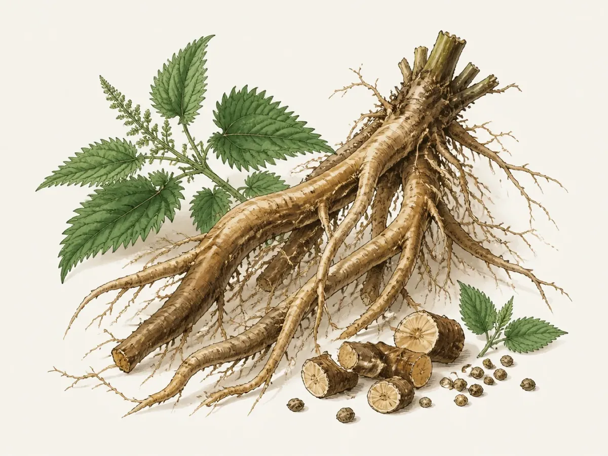

Čaj za prostatu može da ublaži blage tegobe sa mokrenjem, ali ne smanjuje prostatu i ne zamenjuje pregled ni lekove. Najjaču ocenu imaju vrbovica, koren koprive i seme bundeve. Evropska agencija za lekove (EMA) ih navodi kao tradicionalnu podršku kod uvećane prostate, uz uslov da je lekar prethodno isključio ozbiljne uzroke.

> Tekst je informativnog karaktera i ne zamenjuje savet lekara ili farmaceuta. Ne prekidajte i ne menjajte terapiju za prostatu bez lekara.

Uvećana prostata (benigna hiperplazija prostate, BPH) je česta pojava kod starijih muškaraca. Prema MedlinePlus-u, blago uvećanje ima veliki broj muškaraca posle 40. godine, a posle 80. godine više od 90% njih. BPH nije rak i ne povećava rizik od raka prostate. Ipak, isti simptomi mogu da prate i druge bolesti, pa je pregled prvi korak. Ispod je pregled biljaka koje se najčešće nalaze u čajevima za prostatu i šta za njih kažu dokazi.

## Koji čaj za prostatu ima najviše dokaza

| Biljka | Šta kaže EMA ili pregled studija | Na šta paziti |
|---|---|---|
| Vrbovica (*Epilobium angustifolium*, *E. parviflorum*) | tradicionalna upotreba kod tegoba sa mokrenjem zbog BPH | tek posle pregleda kod lekara; nije za mlađe od 18 godina |
| Koren koprive (*Urtica dioica*, radix) | tradicionalna upotreba kod tegoba sa mokrenjem zbog BPH | mogu se javiti tegobe sa stomakom i alergija |
| Seme bundeve (*Cucurbita pepo*) | tradicionalna upotreba kod BPH i preaktivne bešike | blage tegobe sa stomakom kod oko 4% korisnika |
| List breze (*Betula*) | povećava količinu mokraće radi ispiranja mokraćnih puteva | ne kod teških bolesti srca i bubrega |
| List uve (*Arctostaphylos uva-ursi*) | EMA: samo za odrasle žene, najduže nedelju dana | nije ocenjena za prostatu |
| Palma sabal (*Serenoa repens*) | Cochrane 2023: mala ili nikakva korist | dobro se podnosi, ali verovatno ne pomaže |

Sve ocene EMA za ove biljke su „tradicionalne“. To znači da se zasnivaju na najmanje 30 godina upotrebe, od toga 15 u Evropskoj uniji, a ne na čvrstim kliničkim studijama.

## Biljke u čaju za prostatu

Ovo su biljke koje se najčešće nalaze na deklaracijama čajeva i mešavina za prostatu, sa onim što o njima kaže EMA.

### Vrbovica za prostatu

Vrbovica je biljka koju ljudi kod nas najčešće traže kao prirodnu podršku za prostatu. [EMA navodi](https://www.ema.europa.eu/en/medicines/herbal/epilobii-herba) da se herba vrbovice može koristiti kod benigne hiperplazije prostate za ublažavanje tegoba kao što su otežan početak mokrenja i česta potreba za mokrenjem. Važan uslov je da lekar prethodno isključi ozbiljna stanja.

Prema istoj oceni, vrbovica se obično pije kao čaj i može da se koristi duže vreme. U vreme ocene nisu bila prijavljena neželjena dejstva. Za mlađe od 18 godina nema smisla. Količinu i način pripreme uzmite sa pakovanja, jer se proizvodi razlikuju.

### Kopriva za prostatu: koren, a ne list

Kod koprive je bitno koji deo biljke pijete. [Monografija EMA](https://www.ema.europa.eu/system/files/documents/herbal-monograph/urticae-radix-mo_en.pdf) za **koren** koprive navodi tradicionalnu upotrebu za ublažavanje tegoba donjih mokraćnih puteva povezanih sa uvećanom prostatom, opet tek pošto lekar isključi ozbiljne bolesti. Dugotrajna upotreba je moguća.

Moguća neželjena dejstva su mučnina, gorušica, osećaj punoće, gasovi i proliv, kao i alergijske reakcije sa svrabom i osipom. EMA navodi da se lekaru treba javiti ako se tegobe pogoršaju ili ako se jave temperatura, grčevi, krv u mokraći, bolno mokrenje ili zadržavanje mokraće.

Ako na čaju piše samo „kopriva“ ili „list koprive“, ta ocena se na njega ne odnosi.

### Čaj za prostatu i bešiku: seme bundeve

Seme bundeve nije čaj u klasičnom smislu, ali se često nalazi u kapsulama i mešavinama za prostatu. U monografiji EMA seme bundeve je tradicionalni biljni lek za ublažavanje tegoba donjih mokraćnih puteva povezanih sa uvećanom prostatom **ili sa preaktivnom bešikom**, posle pregleda kod lekara. Zato ga ljudi traže i kao „čaj za prostatu i bešiku“.

Dugotrajna upotreba je moguća. Blage tegobe sa stomakom javljaju se kod oko 4% korisnika. Nije za mlađe od 18 godina, a ni za trudnice, jer tegobe sa mokrenjem kod njih traže lekarski nadzor.

### Čaj za prostatu i mokraćne kanale: breza i uva

Mnoge mešavine za prostatu sadrže i biljke koje deluju na mokraćne puteve, a ne na samu prostatu:

1. **List breze.** [EMA navodi](https://www.ema.europa.eu/en/medicines/herbal/betulae-folium) da se tradicionalno koristi kod blagih tegoba mokraćnih puteva, da poveća količinu mokraće i tako ih „ispere“. Koristi se 2 do 4 nedelje. Ne treba ga piti ako vam je lekar savetovao manji unos tečnosti, na primer zbog teške bolesti srca ili bubrega, ni ako ste alergični na polen breze.
2. **List uve (medveđe grožđe).** EMA ga ocenjuje samo za blage, ponavljane infekcije donjih mokraćnih puteva kod **odraslih žena**, najduže nedelju dana. Žene sa bolestima bubrega ne smeju da ga koriste. Za muškarce i za dugotrajno pijenje ta ocena ne važi.

## Šta kažu dokazi o „najboljem“ čaju za prostatu

Najviše kliničkih studija ima palma sabal (*Serenoa repens*), biljka iz mnogih kapsula za prostatu. [Cochrane pregled iz 2023. godine](https://www.cochrane.org/evidence/CD001423) obuhvatio je 27 studija sa 4.656 muškaraca. Zaključak je da sama palma sabal daje malo ili nimalo koristi za tegobe sa mokrenjem, i to su dokazi visoke pouzdanosti. Američki NCCIH je takođe zaključio da palma sabal verovatno ne pomaže kod simptoma uvećane prostate, iako se dobro podnosi.

Za vrbovicu, koren koprive i seme bundeve nema tako velikih pregleda. Njihova ocena se zasniva na dugoj upotrebi. Realno očekivanje je zato skromno: čaj može da bude podrška kod blagih tegoba, ali nije zamena za lekove koje propiše urolog.

## Gotove mešavine za prostatu

U katalogu imamo tri preparata iz ove oblasti. Pre izbora uporedite deo biljke i oblik:

- [Prostamid](/ponude/rs/prostamid/), rinfuz čaj od korena koprive, lista uve, lista breze, lista peršuna i lista ružmarina. Koren koprive i list breze imaju ocene EMA navedene gore. Za list uve EMA ocena važi samo za žene i najduže nedelju dana, pa to imajte u vidu ako planirate da ga pijete duže.
- [Pro Caps](/ponude/rs/pro-caps/), kapsule sa suvim ekstraktom semena bundeve (60 mg), cinkom (15 mg, 150% NRV) i vitaminom E. Ako već pijete multivitamin ili drugi preparat sa cinkom, recite farmaceutu.
- [Pro Drops](/ponude/rs/pro-drops/), kapi sa ekstraktima herbe veronike, lista koprive, lista breze, herbe rastavića i lista uve. Sadrže alkohol, pa nisu za one koji ga ne smeju unositi.

Sve preparate za ovu oblast nađite u kategoriji [prostata i muško zdravlje](/prostata-i-musko-zdravlje/). Na deklaraciji proverite tačan sastav, upozorenja i proizvođača.

## Kome čaj za prostatu nije namenjen

- **Muškarcima koji nisu bili na pregledu.** Ocene EMA važe tek kada lekar isključi ozbiljne uzroke tegoba.
- **Mlađima od 18 godina.** Za njih ove biljke nemaju smisla.
- **Osobama kojima je lekar ograničio unos tečnosti**, zbog srca ili bubrega, kada su u pitanju mešavine sa brezom.
- **Osobama alergičnim** na neku od biljaka iz mešavine.
- **Onima koji piju više lekova**, bez razgovora sa lekarom ili farmaceutom.

## Kada lekaru

Prema MedlinePlus-u, odmah se javite lekaru ako:

- mokrite mnogo manje nego inače,
- imate temperaturu ili drhtavicu,
- osećate bol u leđima, boku ili stomaku,
- vidite krv ili gnoj u mokraći.

EMA u monografiji korena koprive kao razloge za javljanje lekaru navodi i bolno mokrenje, grčeve i zadržavanje mokraće, kada ne možete da se pomokrite.

Na pregled idite i ako imate osećaj da bešika nije prazna posle mokrenja, ako pijete lekove koji mogu da utiču na mokrenje, ili ako mere koje ste sami preduzeli nisu pomogle posle dva meseca. Urolog će proceniti da li su tegobe od prostate ili od nečeg drugog i da li je potrebna terapija.

Koje preglede urolog može da zatraži i šta znači nalaz PSA, objasnili smo u vodiču [uvećana prostata: simptomi, pregledi i kada lekaru](/vodici/uvecana-prostata-simptomi/).
