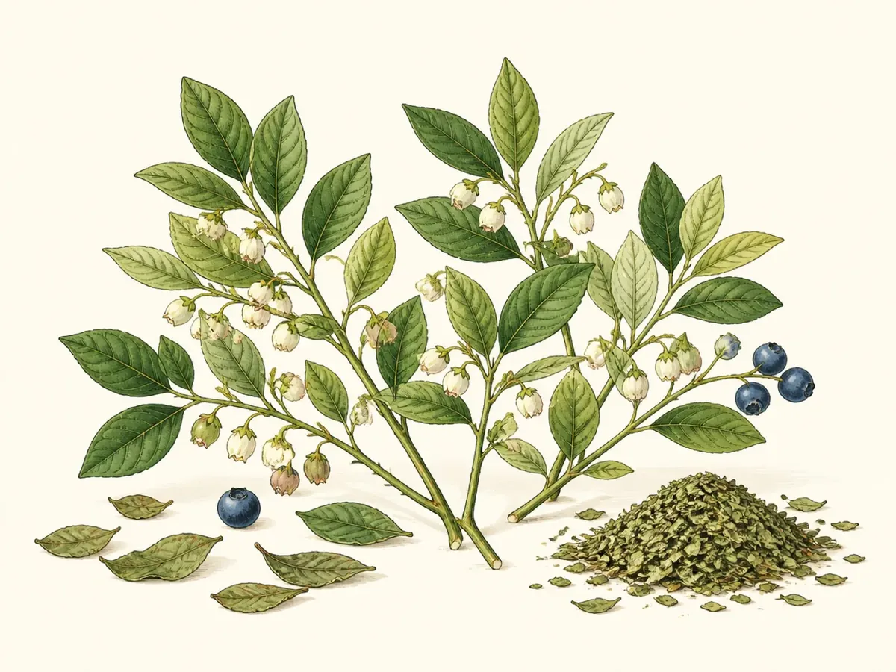

Čaj za šećer u krvi ne može da zameni lekove i nijedna biljka nema dovoljno dokaza da pouzdano snižava šećer. Najviše je proučavan cimet, ali Cochrane pregled nije našao jasan efekat. Biljke iz mešavina „za šećer“, kao što su mahuna pasulja, breza i kleka, Evropska agencija za lekove (EMA) ocenjuje za mokraćne puteve, a ne za šećer.

> Tekst je informativnog karaktera i ne zamenjuje savet lekara ili farmaceuta. Ne prekidajte i ne menjajte terapiju za šećer bez lekara.

Dijabetes je sve češći. Prema Svetskoj zdravstvenoj organizaciji (SZO), broj ljudi sa dijabetesom porastao je sa 200 miliona 1990. godine na 830 miliona 2022. godine. Udeo odraslih sa dijabetesom se za to vreme udvostručio, sa 7% na 14%. Zato mnogi traže i prirodne načine da pomognu sebi. Ispod je pregled biljaka koje se najčešće nalaze u čajevima za šećer i šta za njih kažu dokazi.

## Koji čaj je najbolji za šećer u krvi

| Biljka | Šta kažu dokazi | Na šta paziti |
|---|---|---|
| Cimet (najčešće kasija) | Cochrane 2012: nema dovoljno dokaza za dijabetes | kasija sadrži kumarin; oprez kod bolesti jetre |
| Mahuna pasulja | EMA: blage tegobe mokraćnih puteva; šećer se ne pominje | samo za odrasle |
| List breze | EMA: ispiranje mokraćnih puteva | ne kod teških bolesti srca i bubrega |
| Plod kleke | EMA: ispiranje mokraćnih puteva i varenje | ne kod teških bolesti bubrega, u trudnoći i dojenju |
| List borovnice, lovor, nar, ruzmarin | u izvorima koje smo pregledali nema potvrde za šećer | proverite sastav i upozorenja na pakovanju |
| Zeleni čaj | u izvorima koje smo pregledali nema potvrde za šećer | sadrži kofein |

Američki NCCIH navodi da bi nekoliko dodataka ishrani, kao što su hrom, cimet i berberin, možda moglo da pomogne kontroli šećera. Istovremeno upozorava da istraživanja nisu dovoljno jaka za sigurne zaključke.

## Šta kažu dokazi o biljkama za šećer

### Čaj od cimeta za šećer

Cimet je biljka sa najviše istraživanja na ovu temu. [Cochrane pregled iz 2012. godine](https://www.cochrane.org/evidence/CD007170) obuhvatio je 10 studija sa 577 ljudi sa dijabetesom tipa 1 ili tipa 2. Uglavnom je korišćen cimet kasija, u proseku 2 grama dnevno, od 4 do 16 nedelja.

Rezultati nisu ubedljivi. Efekat na šećer natašte bio je nejasan, a na HbA1c (prosečan šećer za poslednja tri meseca) nije bilo značajne razlike u odnosu na kontrolnu grupu. Autori zaključuju da nema dovoljno dokaza za upotrebu cimeta kod dijabetesa. Većina studija imala je i visok ili nejasan rizik od pristrasnosti.

[NCCIH](https://www.nccih.nih.gov/health/cinnamon) dodaje važno upozorenje. Cimet kasija sadrži kumarin, a neki proizvodi ga imaju u većoj količini. Duža upotreba većih količina može da bude problem za osetljive osobe, na primer one sa bolestima jetre. Cimet kao začin u hrani je, prema istom izvoru, verovatno bezbedan.

### Čaj od mahune pasulja, breze i kleke

Ove biljke su česte u domaćim mešavinama „za šećeraše“. Šta o njima kaže EMA:

1. **Mahuna pasulja.** [EMA](https://www.ema.europa.eu/en/medicines/herbal/phaseoli-fructus-sine-semine) je ocenjuje kao tradicionalnu biljku kod blagih tegoba mokraćnih puteva, jer povećava količinu mokraće i tako ih „ispira“. Namenjena je odraslima. Ako tegobe traju duže od dve nedelje, potreban je lekar. Šećer u krvi se u toj oceni ne pominje.
2. **List breze.** Tradicionalno se koristi takođe za ispiranje mokraćnih puteva, 2 do 4 nedelje. Ne treba ga piti ako vam je lekar savetovao manji unos tečnosti, na primer zbog teške bolesti srca ili bubrega, ni ako ste alergični na polen breze.
3. **Plod kleke.** Prema monografiji EMA, tradicionalno se koristi za ispiranje mokraćnih puteva i kod tegoba sa varenjem, kao što su nadimanje i gasovi. Ne preporučuje se kod teških bolesti bubrega, uključujući upale bubrega, ni u trudnoći i dojenju. Ako tegobe traju duže od dve nedelje, javite se lekaru.

Drugim rečima, ove biljke uglavnom pojačavaju mokrenje. To nije isto što i snižavanje šećera, a kod osoba sa dijabetesom i oslabljenim bubrezima može da zahteva dodatni oprez.

### Čaj od lovora, borovnice i zeleni čaj za šećer

Ljudi često traže i čaj od lovora, lista borovnice, nara, ruzmarina ili zeleni čaj za šećer. U izvorima koje smo pregledali (EMA, Cochrane, NCCIH, SZO) nema potvrde da neka od ovih biljaka snižava šećer u krvi. Zato o njihovom dejstvu ne pišemo. Ako ih pijete, radite to kao deo uobičajene ishrane, a ne kao terapiju.

## Može li čaj za smanjenje šećera u krvi da zameni lek?

Ne. SZO navodi da je za dijabetes tipa 1 neophodan insulin, a da kod tipa 2 neki ljudi uz ishranu i fizičku aktivnost moraju da piju lekove, kao što je metformin, ili da primaju insulin. NCCIH jasno kaže: dodatak ishrani ne uzimajte umesto leka za dijabetes. Prema istom izvoru, američka agencija FDA upozorava i na proizvode koji lažno tvrde da mogu da zamene lekove za dijabetes.

Ako želite da pijete biljni čaj, uz ove uslove:

1. **Ne prekidajte terapiju.** Ni kada su vam vrednosti šećera dobre, jer su dobre upravo zbog terapije.
2. **Recite lekaru šta pijete.** Neki dodaci mogu da stupe u interakciju sa lekovima, a neki su povezivani i sa bolestima bubrega.
3. **Merite šećer** onako kako vam je lekar rekao, posebno prvih nedelja posle uvođenja čaja.
4. **Pijte nezaslađen čaj.** Šećer ili med u čaju poništavaju smisao.

### Šta najviše pomaže kod šećera bez lekova

SZO navodi da su promene načina života najbolji način da se dijabetes tipa 2 spreči ili odloži:

- **zdrava telesna težina**,
- **najmanje 150 minuta umerene fizičke aktivnosti nedeljno**, na primer brzog hodanja,
- **zdrava ishrana**, bez dodatog šećera i sa manje zasićenih masti,
- **bez pušenja**.

Ove navike pomažu i onima koji već piju lekove. SZO među lekovima koji se koriste kod dijabetesa navodi i lekove za pritisak. Ako imate i povišen pritisak, pročitajte i naš vodič [čaj za pritisak](/vodici/caj-za-pritisak/).

## Gotove mešavine za šećer

U katalogu imamo dve biljne mešavine iz ove oblasti:

- [Diatea](/ponude/rs/diatea/), rinfuz čaj od mahune pasulja, lista borovnice, ploda kleke, lista breze, ploda divlje jabuke, korena peršuna i kore cimeta (*Cinnamomum cassia*). Prema onome što smo gore naveli, mahuna pasulja, breza i kleka imaju ocene EMA za mokraćne puteve, a ne za šećer. Cimet u mešavini je kasija, pa važi upozorenje o kumarinu.
- [Dia Drops](/ponude/rs/dia-drops/), kapi sa ekstraktima pasuljevine, lista koprive, lista borovnice, lista breze i herbe belog pelina. Sadrže alkohol, pa nisu za one koji ga ne smeju unositi.

Ostale proizvode za ovu oblast nađite u kategoriji [šećer u krvi](/secer-u-krvi/). Pre nego što izaberete bilo koju mešavinu, proverite tačan sastav, upozorenja i proizvođača na deklaraciji, i dogovorite se sa lekarom.

## Kome čaj za šećer nije namenjen

- **Osobama sa teškim bolestima bubrega ili srca**, kada mešavina sadrži brezu ili kleku.
- **Trudnicama i dojiljama.** Šećer u trudnoći uvek prati lekar.
- **Deci i mladima.** Dijabetes kod njih vodi isključivo lekar.
- **Osobama sa bolestima jetre**, kada mešavina sadrži cimet kasiju.
- **Onima koji su alergični** na neku od biljaka iz mešavine.

## Kada lekaru

Prema SZO, znaci dijabetesa su jaka žeđ, češće mokrenje, zamućen vid, umor i gubitak težine bez namere. Kod dijabetesa tipa 2 simptomi mogu godinama da budu blagi. Ako primetite ove znake, javite se izabranom lekaru i uradite analizu šećera u krvi.

Ako već imate dijabetes, javite se lekaru i ako su vam vrednosti šećera stalno van ciljnih, uprkos terapiji, ili ako primetite nove tegobe posle uvođenja nekog čaja ili dodatka.
