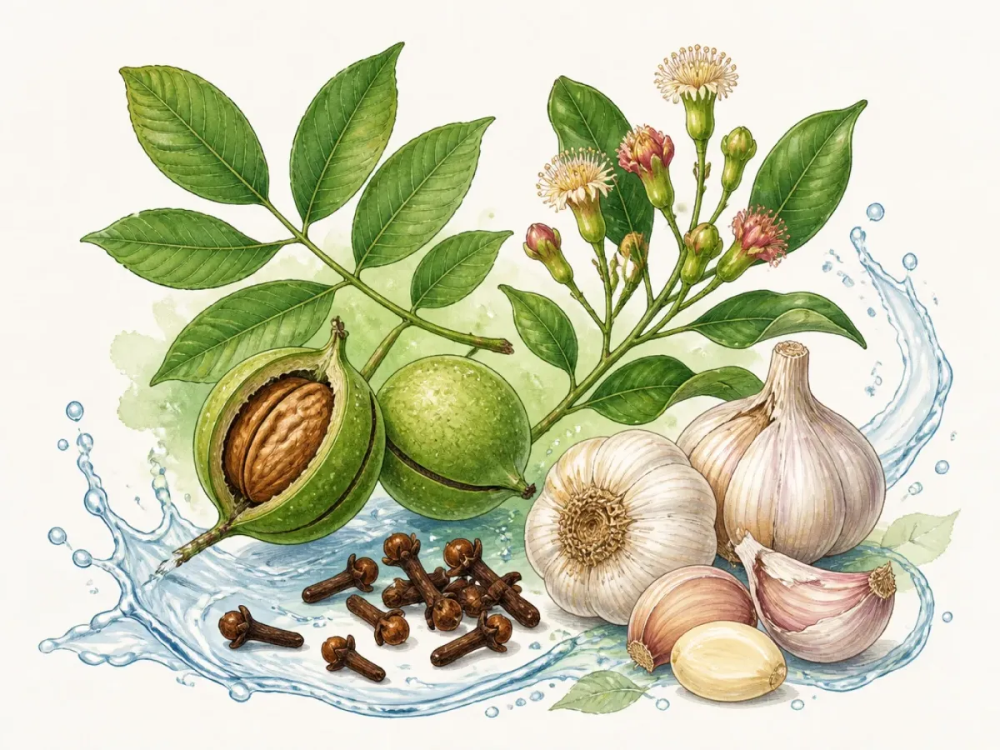

Crevni paraziti kod ljudi najčešće daju proliv, gasove, grčeve i bol u stomaku, a dečje gliste svrab oko čmara, naročito noću. Simptomi se, međutim, javljaju samo kod dela zaraženih. Paraziti se pouzdano dokazuju analizom stolice ili selotejp testom, a leče se lekom koji propisuje lekar.

> Tekst je informativnog karaktera i ne zamenjuje savet lekara ili farmaceuta.

U nastavku su najčešći crevni paraziti, simptomi po kojima se razlikuju, kako izgleda analiza i šta realno možete da očekujete od biljnih preparata.

## Najčešći crevni paraziti kod ljudi

Pod imenom „crevni paraziti“ krije se nekoliko vrlo različitih organizama. Neki su mikroskopski, kao đardija, a neki su crvi vidljivi golim okom. Prenose se na različite načine, pa se razlikuju i simptomi.

| Parazit | Kako se prenosi | Tipični simptomi | Kako se dokazuje |
|---|---|---|---|
| Dečja glista (*Enterobius vermicularis*) | gutanjem jajašaca sa ruku, posteljine, odeće i predmeta | svrab oko čmara, loš san zbog svraba; često bez simptoma | selotejp test |
| Đardija (*Giardia*) | vodom iz neprečišćenih izvora, kontaktom sa zaraženom osobom | proliv, gasovi, grčevi, masna stolica koja pluta | analiza stolice |
| Velika glista (*Ascaris lumbricoides*) | jajašcima iz zemlje, preko neopranog povrća i prljavih ruku | najčešće bez simptoma; bol u stomaku, crvi u stolici | analiza stolice |
| Ankilostome i bičasti crv | zemljom zagađenom izmetom; larve ankilostoma kroz kožu bosih stopala | kod jače zaraze proliv, bol u stomaku, slabost | analiza stolice |

Svetska zdravstvena organizacija (SZO) procenjuje da je glistama koje se prenose preko zemlje zaraženo oko 1,5 milijardi ljudi, odnosno 24% svetske populacije. Jajašca dolaze iz izmeta zaraženih ljudi i dospevaju u zemlju, vodu i na povrće koje nije dobro oprano, oljušteno ili kuvano.

## Crevni paraziti kod odraslih: simptomi

Kod odraslih simptomi često izostanu ili su blagi. Prema [SZO](https://www.who.int/news-room/fact-sheets/detail/soil-transmitted-helminth-infections), ljudi sa malim brojem glista obično nemaju tegobe. Teža zaraza može da izazove proliv, bol u stomaku, malaksalost i lošu ishranjenost.

Znaci koji najčešće vode do analize su:

- **Proliv koji traje nekoliko dana ili duže.** Kod đardije je to najčešći simptom. Prema američkom Centru za kontrolu bolesti (CDC), tegobe počinju jednu do dve nedelje posle zaraze i obično traju dve do šest nedelja.
- **Gasovi, nadimanje i grčevi**, uz mučninu.
- **Masna, neprijatnog mirisa stolica koja pluta.** Tipična je za đardiju.
- **Svrab oko čmara**, jači noću. Ženke dečje gliste noću izlaze u predeo oko čmara i tamo polažu jajašca.
- **Crvi ili delovi crva u stolici.** Kod velike gliste crvi mogu da se vide i u povraćenom sadržaju.
- **Kašalj, zviždanje u grudima i otežano disanje** mogu da se jave kod zaraze velikom glistom.
- **Gubitak težine** bez jasnog razloga, uz tegobe sa stomakom.

### Znaci koji sami po sebi ne dokazuju parazite

Reklame često navode umor, razdražljivost, glad za slatkim ili nadimanje kao „sigurne znake parazita“. Ti znaci imaju mnogo mogućih uzroka, od ishrane i stresa do bolesti štitne žlezde. Sami po sebi ne govore ništa o parazitima, pa nisu razlog za kuru, već eventualno za razgovor sa lekarom.

## Kako se dokazuju paraziti u crevima

Analiza je jednostavna, bezbolna i ne zahteva posebnu pripremu. Postoje dva osnovna testa:

1. **Analiza stolice na jajašca i parazite.** Uzorak se pregleda pod mikroskopom. Prema [MedlinePlus-u](https://medlineplus.gov/lab-tests/ova-and-parasite-test), često je potrebno nekoliko uzoraka iz različitih dana, jer se paraziti ne pojavljuju u stolici svakog dana.
2. **Pravilno uzimanje uzorka.** Stolica se stavlja u čistu, suvu posudu i ne sme da se pomeša sa urinom, toalet-papirom ni vodom iz WC šolje. Posle toga se ruke dobro operu.
3. **Selotejp test za dečje gliste.** Ujutru, pre kupanja i odlaska u toalet, lepljiva traka se pritisne uz kožu oko čmara. Jajašca se zatim traže pod mikroskopom. CDC navodi da za dečje gliste ne postoji test iz krvi.
4. **Krvna slika.** Kod sumnje na veliku glistu lekar ponekad traži i analizu krvi, uključujući broj eozinofila, ili snimak stomaka.

U Srbiji se ove analize rade u domu zdravlja uz uput ili u privatnoj laboratoriji. Ako ste nedavno putovali, pili vodu iz nepoznatog izvora ili bili u kontaktu sa zaraženom osobom, recite to lekaru.

## Lečenje crevnih parazita kod ljudi

Crevni paraziti se leče lekovima, a lek zavisi od vrste parazita. Zato je redosled važan: prvo analiza, pa terapija.

- **Gliste.** SZO za gliste koje se prenose preko zemlje navodi albendazol i mebendazol. MedlinePlus savetuje kontrolnu analizu stolice oko tri meseca posle lečenja velike gliste.
- **Dečje gliste.** CDC navodi dve doze leka, pri čemu se druga daje dve nedelje posle prve. Lek ubija crve, ali ne i jajašca, pa druga doza hvata one koji su se u međuvremenu izlegli. Prema MedlinePlus-u, kada je lek potreban, obično ga piju svi ukućani.
- **Za đardiju i druge mikroskopske parazite** lek takođe bira lekar, prema nalazu analize.

Doziranje uvek određuje lekar ili farmaceut, naročito kod dece, trudnica i starijih osoba.

### Higijena kao deo lečenja

Jajašca dečje gliste mogu da prežive na površinama u kući do dve nedelje. Zato uz lek idu i jednostavne mere: pranje ruku pre jela i posle toaleta, kratki nokti, redovno pranje posteljine, peškira i pidžama i jutarnje tuširanje. Voće i povrće dobro operite, a vodu iz nepoznatih izvora ne pijte.

## Šta kažu dokazi o biljnim preparatima

Nema kliničkih dokaza da biljni čaj, kapsule ili kapi uklanjaju crevne parazite kod ljudi. Pelin, timijan, nana, anis, orah i karanfilić imaju dugu narodnu upotrebu, ali to nije isto što i dokazano dejstvo. Detaljan pregled biljaka i šta za njih kaže Evropska agencija za lekove dali smo u vodiču [čaj za parazite: koje biljke se koriste](/vodici/caj-za-parazite/).

Biljni preparat ne treba da zameni analizu ni lek. Ako vam prija zbog varenja, može da ide uz terapiju, ali samo ako se lekar slaže.

## Gotovi preparati: kako ih uporediti

Ako ipak birate gotov proizvod iz kategorije [paraziti i detoks](/paraziti-i-detoks/), uporedite ih po ovim kriterijumima:

1. **Sastav sa latinskim nazivima** i količinom po porciji.
2. **Jasna upozorenja** za trudnice, dojilje, decu i osobe koje piju lekove.
3. **Proizvođač ili uvoznik** sa adresom u Srbiji.
4. **Obećanja.** Rečenice tipa „očistite telo od parazita za 7 dana“ znače da je reklama ispred dokaza.

Na sajtu opisujemo dva takva proizvoda. [Parazol čaj](/paraziti-i-detoks/parazol/) je mešavina lista masline, vranilove trave (origana), ploda anisa, timijana i lista nane. [Para Caps](/ponude/rs/para-caps/) sadrži suvi ekstrakt lista oraha, pupoljka karanfilića i lukovice belog luka. Ni za jedan od njih ne tvrdimo da uklanja parazite.

### Kome biljni preparati nisu namenjeni

- **Trudnice i dojilje**, jer za većinu ovih biljaka nema dovoljno podataka o bezbednosti.
- **Deca.** Kod deteta sa svrabom oko čmara prvo se radi selotejp test, a terapiju određuje pedijatar.
- **Osobe koje piju lekove**, posebno za razređivanje krvi. Prema američkom centru NCCIH, neki biljni dodaci mogu da pojačaju ili oslabe dejstvo lekova, pa pre upotrebe pitajte farmaceuta.
- **Osobe alergične** na neku od biljaka iz sastava.

## Kada lekaru

Javite se lekaru odmah ako imate krv ili sluz u stolici, visoku temperaturu, jake bolove u stomaku ili znake dehidratacije, kao što su jaka žeđ, suva usta i retko mokrenje. Hitan pregled je potreban i ako povraćate crve ili imate jak bol i nadutost uz izostanak stolice, jer veliki broj glista može da začepi crevo.

Pregled zakažite i ako proliv traje duže od nekoliko dana, ako vidite crve u stolici, ako mršavite bez razloga ili ako se tegobe jave posle putovanja. Osobe sa oslabljenim imunitetom treba da se jave lekaru i kod blažih simptoma.
