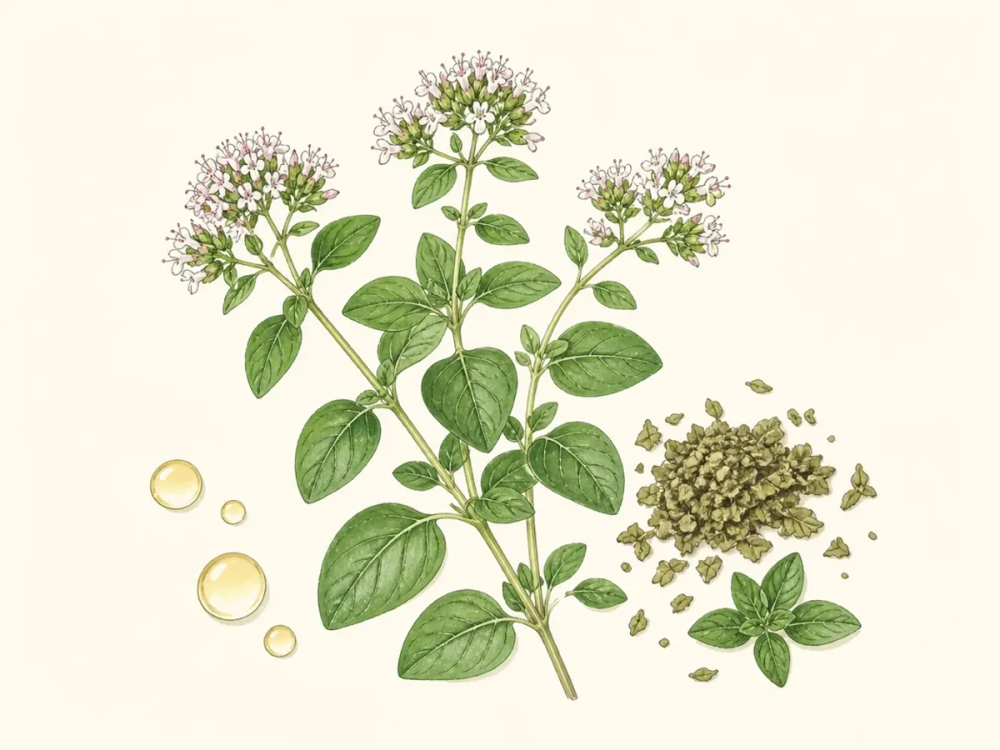

Gljivice na noktima nogu se najpouzdanije leče lekovima koje propisuje lekar, pre svega tabletama terbinafina ili azola. Lečenje traje mesecima, a novi, zdrav nokat može da raste i do godinu dana. Kreme iz slobodne prodaje obično ne pomažu, a za biljna ulja, poput ulja čajevca, nema dovoljno dokaza.

> Tekst je informativnog karaktera i ne zamenjuje savet lekara ili farmaceuta.

Gljivična infekcija nokta je, prema MedlinePlus-u, gljivica koja raste u noktu i oko njega. Mnogo češće zahvata nokte na nogama nego na rukama. Ispod su simptomi, mogućnosti lečenja i šta nezavisni izvori kažu o lekovima i prirodnim preparatima.

## Simptomi i uzroci gljivica na noktima nogu

### Kako izgleda nokat sa gljivicama

[MedlinePlus](https://medlineplus.gov/ency/article/001330.htm) navodi ove promene na jednom ili više noktiju:

- nokat postaje lomljiv i menja oblik,
- ivice se mrve, a ispod nokta se skuplja nečistoća,
- nokat se odvaja od podloge,
- gubi sjaj i zadebljava,
- pojavljuju se bele ili žute pruge.

Američki CDC dodaje da nokti mogu da promene boju, zadebljaju i lako pucaju. Većina gljivičnih infekcija noktiju pripada istoj grupi kao i gljivice na koži stopala.

### Ko je u većem riziku

Infekcija često počinje posle gljivica na koži stopala. Prema MedlinePlus-u i CDC-u, rizik povećavaju:

- dijabetes (više o šećeru u krvi pročitajte u vodiču [čaj za šećer](/vodici/caj-za-secer/)),
- bolesti perifernih krvnih sudova i oštećenje perifernih nerava,
- sitne povrede kože ili nokta,
- koža koja je dugo vlažna i prekomerno znojenje,
- uske cipele i čarape, i obuća koja ne propušta vazduh,
- javni tuševi i svlačionice bez zaštitne obuće,
- oslabljen imunitet i porodična sklonost.

## Gljivice na noktima nogu: lečenje lekovima

Lekar može da potvrdi gljivice pregledom strugotine nokta pod mikroskopom ili kulturom, čiji rezultat stiže za 4 do 6 nedelja. Posle toga bira terapiju. Ovo su glavne mogućnosti i šta o njima kažu dokazi:

| Lečenje | Šta kažu dokazi | Napomena |
|---|---|---|
| Tablete terbinafina | Cochrane 2017: znatno bolje od placeba, dokazi visokog kvaliteta | na recept; verovatno nešto delotvornije od azola |
| Tablete azola | Cochrane 2017: znatno bolje od placeba, dokazi visokog kvaliteta | na recept |
| Lak ili rastvor za nokte | Cochrane 2020: neki su bolji od placeba, ali je potpun uspeh relativno redak | nanosi se mesecima |
| Kreme i masti iz slobodne prodaje | MedlinePlus: obično ne pomažu kod nokta | korisne mogu da budu kod gljivica na koži |
| Laser | Cochrane 2020: dokazi niskog kvaliteta; MedlinePlus: manje delotvoran od lekova | nije zamena za lekove |

### Tablete

[Cochrane pregled iz 2017. godine](https://www.cochrane.org/evidence/CD010031_treatments-fungal-infections-toenails) obuhvatio je 48 studija sa 10.200 učesnika. Terbinafin i azoli su, uz dokaze visokog kvaliteta, mnogo češće dovodili do kliničkog uspeha lečenja nego placebo. Terbinafin je verovatno nešto delotvorniji od azola.

Neželjena dejstva nisu bila češća nego uz placebo. Najčešće su prijavljivani glavobolja, virusna infekcija, mučnina i gubitak čula ukusa. Prema MedlinePlus-u, tablete se za nokte na nogama piju oko 2 do 3 meseca. Za to vreme lekar radi analize krvi da proveri jetru. MedlinePlus navodi i da lekovi otklanjaju gljivice kod otprilike polovine ljudi, a da infekcija može da se vrati i posle uspešne terapije.

### Lak, rastvor i krema za gljivice na noktima nogu

[Cochrane pregled iz 2020. godine](https://www.cochrane.org/evidence/CD012093_topical-treatments-fungal-infections-toenails) obuhvatio je 56 studija sa 12.501 učesnikom. Rastvor efinakonazola bio je bolji od placeba, uz dokaze visokog kvaliteta, a tavaborol verovatno takođe. Lak sa ciklopiroksom možda je bolji od placeba, ali su rezultati skromni. Autori zaključuju da je potpun uspeh lečenja sa preparatima koji se nanose na nokat relativno redak. Nisu svi ovi preparati dostupni kod nas, pa šta je dostupno proverite sa farmaceutom.

### Laser i uklanjanje nokta

Za jednu vrstu lasera (Nd:YAG) Cochrane pregled je našao tri studije sa ukupno 112 učesnika i dokaze niskog kvaliteta. U njima nije bilo jasne razlike u odnosu na lažni tretman ili izostanak tretmana. U nekim slučajevima lekar predlaže i uklanjanje nokta.

## Kako sprečiti da se gljivice vrate

Pošto gljivice lako dolaze nazad, navike su važne koliko i terapija. CDC i MedlinePlus savetuju:

1. Održavajte stopala čistim i suvim, posebno prostor između prstiju.
2. U javnim tuševima, svlačionicama i na bazenu nosite papuče.
3. Menjajte čarape svaki dan i birajte obuću koja propušta vazduh.
4. Ne delite pribor za manikir i pedikir, peškire ni obuću.
5. Nokte držite kratkim i čistim.
6. Gljivice na koži stopala lečite na vreme, uz savet lekara.

## Šta kažu dokazi o prirodnim preparatima

### Ulje čajevca

Ulje čajevca (*Melaleuca alternifolia*) je najčešći biljni sastojak preparata za gljivice. [NCCIH](https://www.nccih.nih.gov/health/tea-tree-oil) navodi da postoji samo nekoliko studija o ulju čajevca kod gljivica na noktima i da ih je premalo i da su previše slabe za bilo kakav zaključak. Kod gljivica na koži stopala možda pomaže, ali možda ne deluje jednako dobro kao standardna terapija.

Evropska agencija za lekove (EMA) ulje čajevca ocenjuje kao tradicionalnu biljku, između ostalog za ublažavanje svraba i iritacije kod blagih gljivica na koži stopala, najduže mesec dana. Nokti se u toj oceni ne pominju. Ulje čajevca nije za decu mlađu od 12 godina. Može da izazove crvenilo, peckanje i alergijsku reakciju na koži, a nikada se ne guta.

### Origano, lavanda, rosopas i drugi kućni recepti

Za ulje origana, nane, lavande i komorača, kao i za kućne recepte, u izvorima koje smo pregledali nema potvrde da pomažu kod gljivica na noktima. Poseban oprez važi za rosopas (*Chelidonium majus*). EMA za njega nije usvojila monografiju. Za upotrebu na usta procenila je da su rizici veći od koristi, zbog prijava oštećenja jetre, a ni upotreba na koži nije dovoljno potkrepljena.

## Gotovi preparati iz kataloga: kako ih uporediti

U katalogu se nalaze dva biljna preparata za spoljnu upotrebu:

- [Mikoherb](/ponude/rs/mikoherb/) je gel od 100 ml sa uljima origana, nane, lavande, komorača i čajevca i ekstraktom kamilice. Deklaracija ne navodi koliko ima ulja čajevca. Sadrži i parabene kao konzervanse, što je važno ako ste na njih alergični. Kao što smo naveli, za ulje čajevca kod noktiju dokazi nisu dovoljni.
- [Mikotea](/ponude/rs/mikotea/) je biljna mešavina za kupku od 50 g: koren sladića i list oraha po 30%, cvet lavande i cvet rosopasa po 20%. Namenjena je samo spoljnoj upotrebi i ne pije se, posebno zbog rosopasa. Za ove biljke u kupki za nokte nismo našli potvrdu u izvorima.

Nijedan od ovih preparata ne zamenjuje lek koji propiše lekar. Ostale proizvode nađite u kategoriji [koža, kosa i nokti](/koza-kosa-i-nokti/). Pre upotrebe uradite probu na malom delu kože.

## Kome biljni preparati za nokte nisu namenjeni

- **Deci mlađoj od 12 godina**, kada preparat sadrži ulje čajevca.
- **Osobama alergičnim** na neku od biljaka, eteričnih ulja ili konzervansa iz sastava.
- **Na oštećenoj ili upaljenoj koži**, bez saveta lekara.
- **Osobama sa dijabetesom, slabom cirkulacijom ili oslabljenim imunitetom**, bez prethodnog pregleda. Kod njih infekcija stopala traži lekara, a ne samostalno lečenje. Više o cirkulaciji pročitajte u kategoriji [vene i cirkulacija](/vene-i-cirkulacija/).
- **Trudnicama i dojiljama**, bez dogovora sa lekarom.

## Kada lekaru

Javite se izabranom lekaru ili dermatologu:

- ako promene na noktu ne prolaze ili se šire na druge nokte,
- ako je prst bolan, crven ili iz njega curi gnoj,
- ako imate dijabetes ili slabu cirkulaciju u nogama, čim primetite promenu na noktu,
- ako niste sigurni da li je reč o gljivicama, jer to može da potvrdi samo analiza,
- pre nego što počnete da pijete bilo kakve tablete za gljivice.
