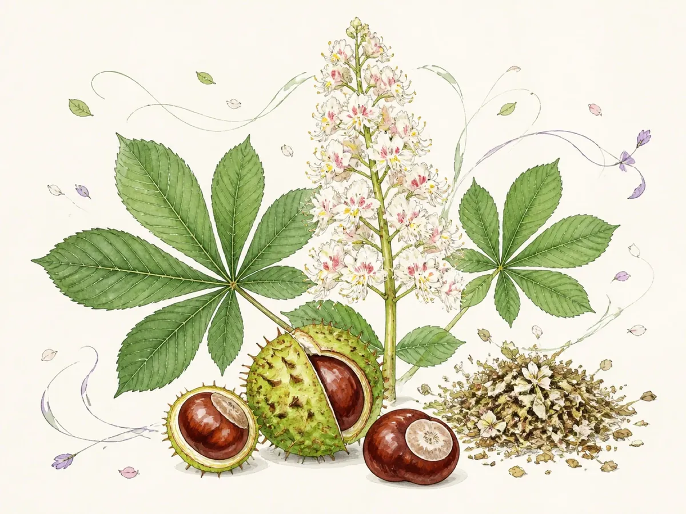

Krema za vene može da ublaži osećaj težine i nelagodnosti u nogama, ali ne uklanja proširene vene ni kapilare. Najviše podataka ima divlji kesten. Evropska agencija za lekove (EMA) kremu i gel sa kestenom priznaje kao tradicionalnu podršku kod teških nogu, dok se jači dokazi iz studija odnose na kapsule.

> Tekst je informativnog karaktera i ne zamenjuje savet lekara ili farmaceuta.

Proširene vene nastaju kada zalisci u venama ne rade dobro, pa se krv zadržava u nogama. Prema MedlinePlus-u, rizik raste sa godinama, češće ih imaju žene (pubertet, trudnoća, menopauza, pilule i hormonska terapija), a doprinose i gojaznost, dugo stajanje ili sedenje, raniji ugrušci u nogama i porodična sklonost. Tipične tegobe su bol i težina u nogama, vidljive proširene vene, kapilari, noćni grčevi, blagi otok oko članaka i svrab. Ispod je pregled šta krema može, a šta ne, i kako da uporedite ponude.

## Šta krema za vene i kapilare može, a šta ne može

| Pristup | Šta kažu izvori | Napomena |
|---|---|---|
| Krema ili gel sa divljim kestenom | EMA: tradicionalna upotreba kod težine i nelagodnosti u nogama i kod modrica | moguće alergijske reakcije na koži |
| Kapsule sa ekstraktom kestena | EMA: dobro utvrđena upotreba kod hronične venske insuficijencije; Cochrane: manji bol i otok | samo standardizovani ekstrakt; uz savet stručnjaka |
| Kompresivne čarape | MedlinePlus: preporučena samopomoć | u jednoj studiji slično kapsulama kestena |
| Podizanje nogu i kretanje | MedlinePlus: preporučena samopomoć | besplatno i bez neželjenih dejstava |
| Skleroterapija, laser, radiofrekvencija | MedlinePlus: metode kojima lekari uklanjaju vene | odluku donosi lekar |

Nijedan izvor koji smo pregledali ne navodi da krema uklanja proširene vene ili kapilare. Za njihovo uklanjanje lekari koriste skleroterapiju, flebektomiju, laser ili radiofrekvenciju.

## Krema za vene od divljeg kestena

Divlji kesten (*Aesculus hippocastanum*) je glavni sastojak većine krema i gelova za vene. [EMA navodi](https://www.ema.europa.eu/en/medicines/herbal/hippocastani-semen) dve vrste upotrebe semena kestena:

1. **Na usta, kod hronične venske insuficijencije.** Ovo je „dobro utvrđena upotreba“, zasnovana na podacima iz studija i najmanje 10 godina primene u EU. Do poboljšanja može da prođe najmanje četiri nedelje.
2. **Na usta ili na kožu, kod nelagodnosti i težine u nogama** zbog blagih problema sa venskom cirkulacijom, kao i kod modrica sa lokalnim otokom. Ovo je „tradicionalna upotreba“, zasnovana na dugoj primeni, a ne na čvrstim studijama.

Krema za vene sa kestenom spada u drugu grupu. Prema EMA, ako nema poboljšanja posle dve nedelje ili se tegobe pogoršaju, treba se javiti lekaru. Kod modrica je granica pet dana. Preparati od kestena su namenjeni odraslima, a na kožu ih kod modrica mogu koristiti i adolescenti. Na koži su prijavljene alergijske reakcije.

## Šta kažu dokazi: krema ili kapsule

[Cochrane pregled iz 2012. godine](https://www.cochrane.org/evidence/CD003230_horse-chestnut-seed-extract-chronic-venous-insufficiency) obuhvatio je 17 studija sa ekstraktom semena kestena **u kapsulama**. U šest od sedam studija koje su ga poredile sa placebom bol u nogama se značajno smanjio. Zapremina noge, kao mera otoka, bila je u proseku manja za oko 32 ml. U jednoj studiji kapsule su delovale slično kao kompresivne čarape. Neželjena dejstva su bila blaga i retka, a autori traže veće i strože studije.

Važno je razumeti šta to znači za kremu: ti rezultati se odnose na kapsule, ne na kreme i gelove. Za kremu sa kestenom imamo samo tradicionalnu ocenu EMA. Zato je realno očekivanje osećaj lakših nogu, a ne smanjenje vena.

Kod kapsula postoji i oprez. Američki [NCCIH](https://www.nccih.nih.gov/health/horse-chestnut) navodi da su sirovo seme, kora, cvet i list kestena nebezbedni za unošenje na usta, jer sadrže otrovnu materiju. Standardizovani ekstrakti su verovatno bezbedni kratkoročno, a mogu da izazovu vrtoglavicu, tegobe sa stomakom, glavobolju i svrab. Nikada ne pravite domaće preparate od kestena za pijenje.

## Kako izabrati kremu za vene na nogama

Kada upoređujete kreme i gelove, gledajte deklaraciju, ne reklamu:

1. **Glavni sastojak.** Divlji kesten ima najviše podataka. Ako ga nema, proverite šta je glavni sastojak i ima li za njega ikakvu ocenu.
2. **Udeo ekstrakta.** Neki proizvođači ga navode, neki ne. Bez tog podatka teško je porediti dva proizvoda.
3. **Podloga.** Gel na bazi karbomera se brzo upija i nije mastan, a krema je masnija i može više da prija suvoj koži.
4. **Eterična ulja.** Lavanda, ružmarin, čempres i kamilica daju miris i osećaj svežine, ali mogu da iritiraju osetljivu kožu.
5. **Konzervansi.** Ako izbegavate parabene, potražite ih u INCI listi (methylparaben, propylparaben).

Kremu nanosite na neoštećenu kožu, laganim pokretima od članaka ka kolenu. Ne stavljajte je na rane, ispucalu ili iritiranu kožu ni na sluzokože. MedlinePlus savetuje da se, ako imate proširene vene, pre upotrebe losiona, krema ili masti sa antibiotikom posavetujete sa lekarom.

### Šta uz kremu najviše pomaže venama

Prema MedlinePlus-u, ove mere su osnova samopomoći kod proširenih vena:

- **Kompresivne čarape**, po preporuci lekara ili farmaceuta.
- **Podizanje nogu** iznad nivoa srca, 3 do 4 puta dnevno po 15 minuta.
- **Izbegavanje dugog stajanja i sedenja.** Pravite pauze i prošetajte.
- **Redovno kretanje**, na primer šetnja ili plivanje.
- **Smanjenje telesne težine**, ako je povećana.
- **Nega suve kože** i pažljivo zbrinjavanje svake ranice na nogama.

Ako vas uz vene muče i bolovi u zglobovima, pogledajte i vodič [krema za zglobove](/vodici/krema-za-zglobove/), jer se kriterijumi za izbor razlikuju.

## Gotove kreme i gelovi za vene

U katalogu imamo dva gela za noge sa kestenom:

- [Varcolex](/ponude/rs/varcolex/), 100 ml, sa ekstraktom divljeg kestena, ekstraktom hajdučke trave i uljima rimske kamilice, lavande, čempresa, ružmarina i pomorandže, na podlozi od karbomera i glicerina.
- [Varcosin](/ponude/rs/varcosin/), sa istim biljnim sastojcima: ekstrakt divljeg kestena, ekstrakt hajdučke trave i ulja ružmarina, lavande, čempresa, rimske kamilice i pomorandže.

Oba proizvoda sadrže parabene i eterična ulja, a udeo ekstrakta kestena nije naveden u INCI listi. Prema onome što smo naveli gore, od njih možete očekivati podršku kod osećaja teških nogu, a ne uklanjanje vena. Ostale proizvode nađite u kategoriji [vene i cirkulacija](/vene-i-cirkulacija/).

## Kome krema za vene nije namenjena

- **Osobama alergičnim** na divlji kesten, hajdučku travu, kamilicu ili neko od eteričnih ulja. Pre prve upotrebe probajte malo gela na unutrašnjoj strani podlaktice.
- **Na oštećenu kožu**, rane, ekcem ili čireve na nogama.
- **Deci.** Preparati od kestena su namenjeni odraslima.
- **Trudnicama**, bez saveta lekara. Proširene vene u trudnoći prati lekar.
- **Osobama koje piju lekove za razređivanje krvi**, bez razgovora sa lekarom.

## Kada lekaru

Prema MedlinePlus-u, javite se lekaru ako su proširene vene bolne, ako se pogoršavaju ili se ne popravljaju uz samopomoć, i ako imate rane na nogama koje ne zarastaju.

Hitno idite na pregled ako primetite nagli porast bola ili otoka, crvenilo noge, toplotu ili temperaturu, posebno ako je otečena samo jedna noga. To može biti znak tromboze, i tu nema mesta za kremu.
