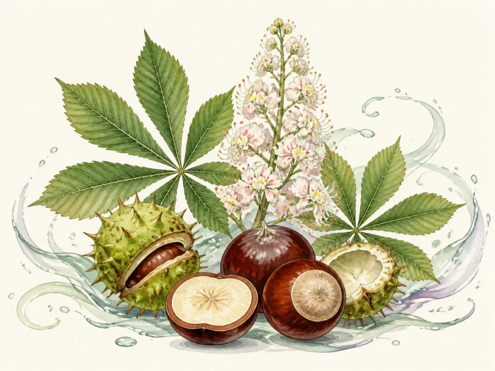

Proširene vene na nogama leče se zahvatima koji zatvaraju ili uklanjaju obolelu venu: toplotom iznutra (radiofrekvencijom ili laserom), ubrizgavanjem sredstva koje je zatvara (skleroterapija) ili operacijom. Britanski NICE kao prvi izbor preporučuje zatvaranje vene toplotom, a operaciju tek kada druge metode nisu pogodne. Kompresivne čarape, kreme i promene navika mogu da ublaže tegobe, ali ne uklanjaju proširene vene.

> Tekst je informativnog karaktera i ne zamenjuje savet lekara ili farmaceuta.

U nastavku su simptomi i uzroci, metode lečenja i redosled koji preporučuje britanski NICE, šta kažu dokazi o kompresivnim čarapama i divljem kestenu, šta možete sami i kada lekaru.

## Proširene vene na nogama: simptomi i uzrok

Proširene vene nastaju kada zalisci u venama ne rade dobro, pa se krv vraća i zadržava u veni. Prema [MedlinePlus-u](https://medlineplus.gov/ency/article/001109.htm), rizik raste sa godinama, a češće ih imaju žene, zbog hormonskih promena, pilula i hormonske terapije. Doprinose i trudnoća, gojaznost, dugo stajanje ili sedenje, raniji ugrušci u nogama i porodična sklonost.

NICE kao tipične simptome navodi bol, tupi bol, nelagodnost, otok, težinu i svrab u nogama. Neki ljudi nemaju tegoba osim izgleda vena. Kod drugih se javljaju i promene na koži potkolenice, kao što su tamnije prebojavanje ili ekcem, što je razlog za pregled.

### Proširene vene i otečene noge

Otok i težina u nogama spadaju među tipične tegobe kod proširenih vena. Nagli porast otoka ili bola i crvenilo noge nisu uobičajeni i traže brz pregled (više u delu „Kada lekaru“).

## Kako se leče proširene vene na nogama

Pre lečenja vaskularni hirurg radi dopler (dupleks) ultrazvuk vena. NICE navodi da se njime potvrđuje dijagnoza, vidi koliko su velike vene zahvaćene i planira lečenje. Metode koje se danas koriste, prema [MedlinePlus-u](https://medlineplus.gov/ency/article/007395.htm):

| Metoda | Kako se radi | Napomena |
|---|---|---|
| Endotermalna ablacija | tanak kateter se uvodi u venu i toplotom (radiofrekvencijom ili laserom) je zatvara | NICE je navodi kao prvi izbor |
| Skleroterapija | u venu se ubrizgava rastvor koji je zatvara, pa ona vremenom nestaje | najbolje deluje kod kapilara; penom pod ultrazvukom NICE je navodi kao drugi izbor |
| Laser preko kože | kratki impulsi svetlosti deluju na male vene | male površinske vene |
| Flebektomija | kroz vrlo male rezove odstranjuje se površinska vena | površinske proširene vene |
| Operacija (podvezivanje i uklanjanje vene) | klasičan hirurški zahvat | kada druge metode nisu pogodne |

Ablacija, skleroterapija i flebektomija rade se u lokalnoj anesteziji, pa ste budni, ali ne osećate bol. MedlinePlus navodi da se noga posle zahvata previje na 2 do 3 dana, da se uobičajene aktivnosti nastavljaju posle 1 do 2 dana i da se kompresivne čarape nose tokom dana oko nedelju dana.

### Redosled lečenja prema NICE

Britanski [NICE](https://www.nice.org.uk/guidance/cg168/ifp/chapter/Treatments) za proširene vene koje daju tegobe preporučuje ovaj redosled:

1. **Endotermalna ablacija**, ako je pogodna za vas.
2. **Skleroterapija penom pod kontrolom ultrazvuka**, ako ablacija nije pogodna.
3. **Operacija**, najčešće podvezivanje i uklanjanje vene, ako ni jedno ni drugo nije pogodno.

Ako vam posle zahvata daju zavoje ili čarape, NICE navodi da ih ne treba nositi duže od 7 dana.

### Proširene vene i kapilari na nogama: lečenje

Kapilari (paukaste venice) su vrlo male proširene vene. MedlinePlus navodi da skleroterapija najbolje deluje upravo kod njih, a koristi se i laser preko kože. MedlinePlus navodi da su ovi zahvati uglavnom bezbedni. Mogući rizici su modrice ili ožiljci, iritacija vene, ugrušak, oštećenje nerva i to da se vena ne zatvori ili se ponovo otvori. Proširene vene mogu i da se vrate vremenom.

## Kompresivne čarape: kada imaju smisla

Čarape spolja pritiskaju nogu. MedlinePlus ih navodi među merama samopomoći i navodi da posle zahvata pomažu da se problem ne vrati. Ipak, [Cochrane pregled iz 2021.](https://www.cochrane.org/CD008819) obuhvatio je 13 studija sa 1.021 učesnikom i zaključio da nema dovoljno pouzdanih dokaza da su čarape delotvorne kao jedino i prvo lečenje proširenih vena bez rana. Nije mogao ni da odredi koja dužina ili jačina pritiska je najbolja. Neželjena dejstva su bila blaga, uglavnom svrab i iritacija kože.

Zato NICE navodi da kompresivne čarape ne treba nuditi kao trajno lečenje proširenih vena, osim kada zahvat nije pogodan. Kratko nošenje posle zahvata je nešto drugo i deo je oporavka.

## Proširene vene na nogama: prirodni lek i šta kažu dokazi

Ljudi često traže prirodni lek za vene. Nijedna biljka ne uklanja proširene vene, ali za divlji kesten postoje podaci da može da ublaži tegobe.

- **Seme divljeg kestena na usta.** [EMA](https://www.ema.europa.eu/en/medicines/herbal/hippocastani-semen) ga priznaje kao dobro ustanovljenu upotrebu kod hronične venske insuficijencije, sa tegobama kao što su otečene noge, proširene vene, težina, bol, umor, svrab i grčevi u listovima. Poboljšanje se očekuje posle najmanje 4 nedelje.
- **Cochrane pregled iz 2012.** obuhvatio je 17 studija. U većini studija sa placebom ekstrakt semena kestena je smanjio bol u nogama, a slični rezultati su prijavljeni za otok, obim noge i svrab. Zaključak je da je to delotvorna i bezbedna kratkotrajna terapija, ali da su potrebne veće studije.
- **Krema i gel sa kestenom.** EMA ih navodi kao tradicionalnu upotrebu za ublažavanje nelagodnosti i težine u nogama zbog blagih problema sa venama. Ako se tegobe ne poprave za 2 nedelje, potrebno je javiti se lekaru.

Američki NCCIH upozorava da su sirovo seme, kora, cvet i list divljeg kestena nebezbedni za upotrebu na usta. Standardizovan ekstrakt semena smatra se verovatno bezbednim za kraću upotrebu, a u studijama je korišćen do 12 nedelja. Više o kremama pročitajte u vodiču [krema za vene i kapilare: kako izabrati](/vodici/krema-za-vene/).

### Gotovi gelovi za vene

U kategoriji [vene i cirkulacija](/vene-i-cirkulacija/) opisujemo dva gela sa ekstraktom divljeg kestena. Oba se nanose na kožu i mogu biti dodatak, a ne zamena za pregled i lečenje.

- [Varcolex](/ponude/rs/varcolex/) sadrži ekstrakt divljeg kestena, ekstrakt hajdučke trave i ulja rimske kamilice, lavande, čempresa, ružmarina i pomorandže.
- [Varcosin](/ponude/rs/varcosin/) ima iste biljne sastojke: ekstrakt divljeg kestena, ekstrakt hajdučke trave i ulja ružmarina, lavande, čempresa, rimske kamilice i pomorandže.

### Kome preparati sa kestenom nisu namenjeni

- **Deci.** EMA navodi da su preparati od semena kestena za odrasle, a mazanje kože kod adolescenata predviđa samo za modrice.
- **Trudnicama i dojiljama**, jer prema NCCIH-u malo se zna o bezbednosti u tom periodu.
- **Osobama alergičnim** na neki sastojak. EMA kod upotrebe na koži navodi moguće alergijske reakcije.
- **Onima koji piju lekove**, bez razgovora sa lekarom ili farmaceutom.

Gel ne stavljajte na rane, ispucalu ili iritiranu kožu.

## Prevencija i šta možete sami

MedlinePlus kao samopomoć kod proširenih vena savetuje sledeće:

1. **Krećite se.** Hodanje ili plivanje oko 30 minuta, najbolje 5 puta nedeljno.
2. **Podižite noge** iznad nivoa srca 3 do 4 puta dnevno, po 5 do 15 minuta.
3. **Ne stojte i ne sedite dugo bez pauze.** Ako morate, savijajte i ispružite noge na nekoliko minuta.
4. **Smršajte ako imate višak kilograma**, uz savet lekara.
5. **Nosite kompresivne čarape** ako ih je lekar preporučio.
6. **Pazite na kožu.** Ne stavljajte na noge kreme sa antibiotikom, kortikosteroidom ili sredstvom za umrtvljivanje bez saveta lekara i proveravajte da li se oko članaka javljaju ranice.

## Kada lekaru

Prema MedlinePlus-u, javite se lekaru ako su proširene vene bolne, ako se pogoršavaju ili se ne popravljaju uz samopomoć. Bez odlaganja se javite ako imate nagli porast bola ili otoka, temperaturu, crvenilo noge ili rane na nogama koje ne zarastaju.

NICE upućivanje vaskularnom hirurgu predviđa kod proširenih vena koje daju tegobe, promena na koži potkolenice kao što su prebojavanje ili ekcem, tvrdih i bolnih površinskih vena (upala vene), rane ispod kolena koja ne zarasta 2 nedelje i ranije zarasle venske rane.
