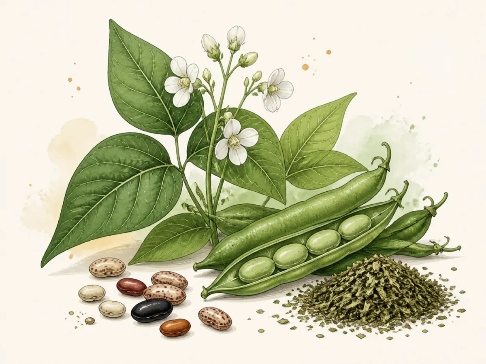

Normalne vrednosti za šećer u krvi natašte su od 3,9 do 5,5 mmol/L (70–99 mg/dL). Vrednosti od 5,6 do 6,9 mmol/L ukazuju na predijabetes, a 7,0 mmol/L ili više, izmereno u dva navrata, obično znači šećernu bolest. Dva sata posle testa opterećenja glukozom normalno je da šećer bude ispod 7,8 mmol/L.

> Tekst je informativnog karaktera i ne zamenjuje savet lekara ili farmaceuta. Ako pijete lekove za šećer, ne prekidajte i ne menjajte terapiju bez lekara.

U nastavku su granice za šećer natašte, posle jela i za HbA1c, objašnjenje nalaza koji ljudi najčešće pretražuju (6,5 i 7), znaci niskog šećera i kada sa nalazom treba lekaru.

## Šećer u krvi: normalne vrednosti natašte

Šećer natašte meri se posle najmanje 8 sati bez hrane, najčešće ujutru. U Srbiji se rezultat izražava u mmol/L, a u američkim izvorima u mg/dL. Granice prema [MedlinePlus-u](https://medlineplus.gov/ency/article/003482.htm) i [CDC-u](https://www.cdc.gov/diabetes/diabetes-testing/index.html):

| Test | Normalno | Predijabetes | Šećerna bolest |
|---|---|---|---|
| Šećer natašte | 3,9–5,5 mmol/L (70–99 mg/dL) | 5,6–6,9 mmol/L (100–125 mg/dL) | 7,0 mmol/L (126 mg/dL) ili više, u dva navrata |
| Test opterećenja glukozom, posle 2 sata | ispod 7,8 mmol/L (140 mg/dL) | 7,8–11,0 mmol/L (140–199 mg/dL) | 11,1 mmol/L (200 mg/dL) ili više |
| Šećer izmeren bilo kada | obično 6,9 mmol/L ili manje | – | 11,1 mmol/L (200 mg/dL) ili više |
| HbA1c (glikozilirani hemoglobin) | ispod 5,7% | 5,7–6,4% | 6,5% ili više |

Predijabetes znači da je šećer viši od normalnog, ali još ne toliko da bi se postavila dijagnoza šećerne bolesti. Zato je to dobar trenutak za razgovor sa lekarom o navikama i kontrolama.

### Šećer u krvi: referentne vrednosti na nalazu

Na nalazu iz laboratorije pored rezultata stoji referentni opseg. MedlinePlus navodi da se opsezi mogu malo razlikovati između laboratorija, pa uvek gledajte onaj koji piše na vašem nalazu. Šećer izmeren iz vene smatra se tačnijim od merenja aparatom iz prsta. Zato se dijagnoza postavlja na osnovu laboratorijskih nalaza, a ne kućnog aparata.

MedlinePlus navodi i da kod nekih ljudi, uglavnom mladih i mršavih, šećer natašte ispod 3,9 mmol/L može da bude normalan.

## Šećer u krvi posle jela

Posle obroka šećer prirodno raste, a koliko i koliko brzo zavisi od toga šta ste jeli i kada. Zato ne postoji jedna „normalna“ vrednost za svaki obrok. MedlinePlus navodi da je šećer izmeren u bilo koje doba dana najčešće 6,9 mmol/L ili niži.

Kada lekar želi da proveri kako telo podnosi šećer, traži test opterećenja glukozom (OGTT). Prema [MedlinePlus-u](https://medlineplus.gov/ency/article/003466.htm), test izgleda ovako:

1. Nekoliko dana pre testa jedite kao i obično.
2. Najmanje 8 sati pre testa ne jedite i ne pijte ništa.
3. Prvo vam izvade krv natašte.
4. Popijete napitak sa određenom količinom glukoze, najčešće 75 grama.
5. Krv se vadi ponovo, na 30 do 60 minuta. Ceo test može da traje do 3 sata.

Normalno je da dva sata posle napitka šećer bude ispod 7,8 mmol/L. Vrednosti od 7,8 do 11,0 mmol/L znače smanjenu toleranciju glukoze, a 11,1 mmol/L ili više ukazuje na šećernu bolest.

## Šećer u krvi 6,5 ili 7: šta znači nalaz

Ovo su brojevi koje ljudi najčešće pretražuju, jer su blizu granica.

- **Šećer natašte 5,6 do 6,9 mmol/L.** Iznad normale, u opsegu predijabetesa. Nalaz 6,2 ili 6,5 spada ovde. Ponovite analizu i pokažite rezultat lekaru.
- **Šećer natašte 7,0 mmol/L ili više.** Prema MedlinePlus-u, ovakav rezultat na dva različita testa obično znači šećernu bolest. Jedan nalaz nije dovoljan za dijagnozu, ali jeste razlog za pregled.
- **HbA1c 6,5%.** Ovo nije isto što i šećer 6,5 mmol/L. HbA1c pokazuje prosečan šećer u poslednjih nekoliko meseci, a vrednost od 6,5% ili više, prema CDC-u, ukazuje na šećernu bolest.
- **Šećer 11,1 mmol/L ili više u bilo koje doba dana.** Prema MedlinePlus-u, ovakva vrednost često znači šećernu bolest. Javite se lekaru što pre.

### Ciljne vrednosti kod osoba sa dijabetesom

Kod osoba koje već imaju šećernu bolest, ciljeve određuje lekar. Britanski [NICE](https://www.nice.org.uk/guidance/NG28/chapter/blood-glucose-management) za odrasle sa dijabetesom tipa 2 kao cilj navodi HbA1c od 48 mmol/mol (6,5%) kada se šećer kontroliše ishranom i lekovima koji ne izazivaju hipoglikemiju. Za one koji piju lekove koji mogu previše da spuste šećer, cilj je 53 mmol/mol (7,0%). NICE ne savetuje rutinsko merenje šećera aparatom kod kuće za sve, nego, na primer, za one koji su na insulinu ili su imali epizode niskog šećera.

## Nizak šećer u krvi: kada je prenizak

Prema [CDC-u](https://www.cdc.gov/diabetes/about/low-blood-sugar-hypoglycemia.html), šećer ispod 3,9 mmol/L (70 mg/dL) smatra se niskim, a ispod 54 mg/dL, odnosno oko 3,0 mmol/L, ozbiljno niskim. Nizak šećer se javlja kod osoba koje primaju insulin ili piju neke lekove za šećer, ali MedlinePlus navodi i druge uzroke, kao što su premalo hrane, jako fizičko naprezanje i bolesti jetre ili bubrega.

Česti znaci niskog šećera su ubrzan rad srca, drhtanje, znojenje, nervoza, razdražljivost ili zbunjenost, vrtoglavica i glad. Kod ozbiljno niskog šećera javljaju se slabost, otežan hod ili vid, neobično ponašanje i napadi grčeva. CDC upozorava da neki ljudi nemaju nikakve simptome kada im šećer padne.

## Šta kažu dokazi: navike, lekovi i biljke

Svetska zdravstvena organizacija ([SZO](https://www.who.int/News-Room/Fact-Sheets/Detail/Diabetes)) navodi da je 2022. godine 14% odraslih živelo sa šećernom bolešću. Za sprečavanje dijabetesa tipa 2 SZO savetuje zdravu telesnu težinu, najmanje 150 minuta umerene fizičke aktivnosti nedeljno, zdravu ishranu sa malo šećera i zasićenih masti i nepušenje. Kada to nije dovoljno, lekar uvodi lekove.

**Ne prekidajte i ne menjajte terapiju za šećer bez lekara.** Za dodatke ishrani američki centar [NCCIH](https://www.nccih.nih.gov/health/tips/things-to-know-about-type-diabetes-and-dietary-supplements) navodi:

- dodatak ishrani ne treba uzimati umesto leka za šećer,
- pre uzimanja bilo kog dodatka razgovarajte sa lekarom, jer neki mogu da utiču na dejstvo lekova,
- za hrom, cimet i berberin postoje naznake da bi mogli malo da pomognu, ali istraživanja nisu dovoljno jaka za čvrste zaključke,
- proizvodi koji zvuče previše dobro da bi bili istiniti mogu da budu prevara.

Biljke iz čajeva za šećer i šta za njih kaže Evropska agencija za lekove opisali smo u vodiču [čaj za šećer u krvi: koje biljke se koriste](/vodici/caj-za-secer/).

### Gotovi preparati: kako ih uporediti

U kategoriji [šećer u krvi](/secer-u-krvi/) opisujemo nekoliko preparata. Nijedan ne snižava šećer umesto leka. Ako ih birate kao dodatak, uporedite sastav i upozorenja i pitajte lekara.

- [Diatea](/ponude/rs/diatea/) je rinfuz čaj od mahune pasulja, lista borovnice, ploda kleke, lista breze, ploda divlje jabuke, korena peršuna i kore cimeta (*Cinnamomum cassia*).
- [Dia Drops](/ponude/rs/dia-drops/) su kapi sa ekstraktima pasuljevine, lista koprive, lista borovnice, lista breze i herbe belog pelina. Sadrže alkohol.

### Kome nisu namenjeni

- **Osobama koje piju lekove za šećer ili primaju insulin**, bez razgovora sa lekarom, jer neki dodaci mogu da utiču na dejstvo lekova.
- **Trudnicama i dojiljama**, bez dogovora sa lekarom, jer šećer u trudnoći prati lekar.
- **Mlađima od 18 godina.**
- **Osobama koje ne smeju da unose alkohol**, kada su u pitanju kapi.

## Kada sa nalazom lekaru

Javite se lekaru ako vam je šećer natašte 5,6 mmol/L ili viši, ako je HbA1c 5,7% ili viši, ili ako imate znake visokog šećera. SZO među njima navodi jaku žeđ, češće mokrenje nego inače, zamućen vid, umor i nenamerno gubljenje težine. Kod dijabetesa tipa 2 simptomi mogu da budu blagi i da se primete tek posle nekoliko godina, pa redovne kontrole imaju smisla i kada se osećate dobro.

Hitnu pomoć na **194** zovite ako osoba sa niskim šećerom postane zbunjena, ne može da hoda ili jasno vidi, ili ima napad grčeva. Hitno lekaru treba i ako je šećer 11,1 mmol/L ili viši uz jaku žeđ, često mokrenje ili malaksalost.
