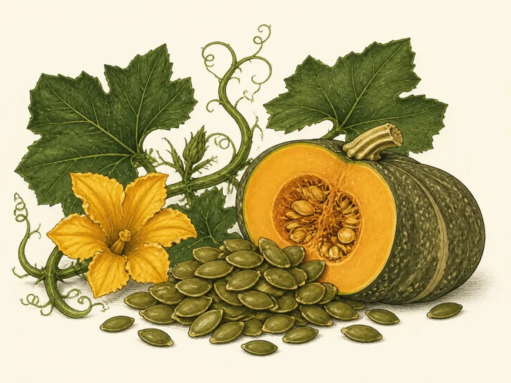

Uvećana prostata najčešće daje simptome kao što su slab ili isprekidan mlaz, otežan početak mokrenja, učestalo i noćno mokrenje i osećaj da bešika nije prazna. Simptomi ne zavise uvek od veličine prostate, a isti znaci mogu da prate i druge bolesti. Zato dijagnozu postavlja lekar, posle razgovora, pregleda i nekoliko jednostavnih analiza.

> Tekst je informativnog karaktera i ne zamenjuje savet lekara ili farmaceuta. Ne prekidajte i ne menjajte terapiju za prostatu bez lekara.

Lekari ovo stanje zovu benigna hiperplazija prostate (BPH). Prema američkom institutu NIDDK, to je rast prostate koji nije izazvan rakom. U nastavku su simptomi, uzroci, pregledi koje urolog najčešće traži, šta možete sami i kada je potrebna hitna pomoć.

## Uvećana prostata: simptomi koje treba prepoznati

Prostata obavija mokraćnu cev odmah ispod bešike. Kada se uveća, može da suzi taj prolaz i da otežava pražnjenje bešike. Prema [MedlinePlus-u](https://medlineplus.gov/ency/article/000381.htm), manje od polovine muškaraca sa BPH ima simptome. Kod onih koji ih imaju, tegobe se dele u dve grupe.

| Simptom | Kako izgleda u praksi |
|---|---|
| Slab ili isprekidan mlaz | mlaz je tanji, prekida se ili traje duže |
| Otežan početak mokrenja | morate da čekate ili da se napinjete da bi mokrenje krenulo |
| Kapanje na kraju | posle mokrenja još malo curi |
| Osećaj da bešika nije prazna | ubrzo posle mokrenja opet osećate potrebu |
| Učestalo mokrenje | idete u toalet mnogo češće nego ranije |
| Nagli, jak nagon | teško možete da odložite odlazak u toalet |
| Noćno mokrenje | budite se dva ili više puta noću zbog mokrenja |
| Bol pri mokrenju ili krv u mokraći | može da znači infekciju, javite se lekaru |

Prva četiri reda u tabeli odnose se na pražnjenje bešike, a sledeća tri na njeno punjenje. Neki muškarci imaju samo jednu vrstu tegoba, a neki obe.

### Veličina prostate i simptomi nisu isto

Mnogi misle da veća prostata znači i jače tegobe. NIDDK navodi da to nije pravilo. Velika prostata ponekad skoro ne utiče na mokrenje, a samo blago uvećana može da daje izražene simptome. Zato urolog ne gleda samo nalaz ultrazvuka, već i koliko vam tegobe smetaju u svakodnevnom životu.

## Uvećana prostata kod muškaraca: uzrok i ko je u riziku

Tačan uzrok nije poznat. NIDDK navodi da naučnici ne znaju sigurno zašto BPH nastaje, a da se kao razlog najčešće pominju starenje i promene hormona.

Uvećana prostata je vrlo česta posle srednjih godina:

- prema NIDDK, ima je 5–6% muškaraca od 40 do 64 godine i 29–33% muškaraca od 65 i više godina,
- prema MedlinePlus-u, blago uvećanje ima mnogo muškaraca posle 40. godine, a posle 80. godine više od 90% njih,
- pre 40. godine BPH retko daje simptome.

Rizik je veći ako u porodici ima muškaraca sa BPH, kao i kod bolesti srca i krvnih sudova, šećerne bolesti tipa 2, gojaznosti, hronične bolesti bubrega i erektilne disfunkcije. NIDDK među faktorima rizika navodi i nedovoljnu fizičku aktivnost.

### Lekovi koji mogu da pojačaju tegobe

Neki lekovi mogu da pogoršaju simptome uvećane prostate. NIDDK i MedlinePlus navode lekove za prehladu i kašalj sa dekongestivima ili antihistaminicima, sredstva za smirenje, neke antidepresive i diuretike. Ne prestajte da ih pijete na svoju ruku. Recite lekaru ili farmaceutu da imate tegobe sa mokrenjem, pa će proceniti da li je potrebna promena.

## Pregledi kod uvećane prostate: kako se postavlja dijagnoza

Dijagnoza se postavlja na osnovu razgovora, fizičkog pregleda i analiza. Prema NIDDK i MedlinePlus-u, urolog najčešće radi sledeće:

1. **Razgovor o tegobama.** Lekar pita kada su tegobe počele, koliko često mokrite noću, koje lekove pijete, koliko tečnosti, kafe i alkohola unosite i da li je neko u porodici imao BPH. Ponekad ćete popuniti i kratak upitnik o težini simptoma.
2. **Digitorektalni pregled.** Lekar prstom, kroz završno crevo, proverava veličinu, oblik i čvrstinu prostate.
3. **Analiza urina.** Pokazuje da li postoji infekcija ili krv u mokraći. Po potrebi se radi i urinokultura.
4. **PSA iz krvi.** Meri protein koji stvara prostata (više o tome ispod).
5. **Ultrazvuk i rezidualni urin.** Ultrazvukom se može proceniti veličina prostate i koliko mokraće ostaje u bešici posle mokrenja.
6. **Merenje protoka mokraće.** Pokazuje koliko je mlaz jak i koliko dugo traje mokrenje.
7. **Dodatne analize po proceni lekara.** To mogu biti urea i kreatinin za rad bubrega, urodinamski testovi, cistoskopija ili, kada je potrebno, biopsija prostate.

### PSA kod uvećane prostate

PSA je protein koji stvara prostata. Prema [MedlinePlus-u](https://medlineplus.gov/lab-tests/prostate-specific-antigen-psa-test), povišen PSA ne znači automatski rak. Može da bude povišen i zbog uvećane prostate, upale prostate (prostatitisa), infekcije mokraćnih puteva ili nekih lekova. Sam test ne može da pokaže šta je uzrok, a ne postoji ni jedna granica koja važi za sve.

Pred PSA test 24 sata izbegavajte seks i masturbaciju, jer to može da utiče na rezultat. Lekove nemojte prekidati bez dogovora sa lekarom. Ako je PSA povišen, lekar može da ponovi test ili da zatraži dodatne preglede.

## Šta možete sami kod blagih tegoba

Ako je prostata blago uvećana i tegobe vam ne smetaju mnogo, lekar može da predloži praćenje uz promene navika. NIDDK i MedlinePlus navode sledeće:

- **Ograničite alkohol i kafu**, posebno posle večere.
- **Ne pijte mnogo tečnosti dva sata pred spavanje** ni pre izlaska, ali tokom dana pijte dovoljno.
- **Mokrite čim osetite potrebu** i pokušajte da potpuno ispraznite bešiku. Može da pomogne i odlazak u toalet u redovnim razmacima.
- **Budite fizički aktivni** i trudite se da vam bude toplo.
- **Proverite lekove za prehladu** pre kupovine, jer dekongestivi i antihistaminici mogu da pojačaju tegobe.

### Uvećana prostata i ishrana

Mnogi traže posebnu ishranu za prostatu. NIDDK navodi da istraživači nisu pronašli da ishrana izaziva BPH ili da je sprečava. Uravnotežena ishrana i normalna telesna težina ipak su važni, jer su gojaznost i šećerna bolest faktori rizika.

## Uvećana prostata: lečenje i šta kažu dokazi o biljkama

Lečenje bira urolog, prema tome koliko su tegobe jake i koliko vam smetaju. NIDDK navodi tri glavna pravca: praćenje uz promene navika, lekove i zahvate. Lekovi uglavnom opuštaju mišiće vrata bešike i prostate ili usporavaju rast prostate. Kada lekovi ne pomažu ili se jave komplikacije, razmatra se operacija. MedlinePlus navodi da je transuretralna resekcija prostate (TURP) najčešći i najbolje proveren hirurški zahvat.

Za biljke dokazi su skromniji:

- **Vrbovica.** [EMA navodi](https://www.ema.europa.eu/en/medicines/herbal/epilobii-herba) da se, na osnovu duge upotrebe, može koristiti za ublažavanje tegoba kao što su otežan početak mokrenja i česta potreba za mokrenjem kod BPH. Uslov je da lekar prethodno isključi ozbiljna stanja. Za mlađe od 18 godina nema smisla.
- **Seme bundeve.** U monografiji EMA je tradicionalni biljni lek za ublažavanje tegoba donjih mokraćnih puteva kod BPH ili preaktivne bešike, takođe tek posle pregleda kod lekara. Blage tegobe sa stomakom javljaju se kod oko 4% korisnika.
- **Palma sabal.** [Cochrane pregled iz 2023.](https://www.cochrane.org/evidence/CD001423) obuhvatio je 27 studija sa 4.656 muškaraca i zaključio da sama palma sabal daje malo ili nimalo koristi kod tegoba sa mokrenjem.

Ocene EMA za vrbovicu i seme bundeve su tradicionalne. Zasnivaju se na dugoj upotrebi, a ne na čvrstim kliničkim studijama. Nijedna biljka ne smanjuje prostatu i ne zamenjuje lekove. Više o pojedinačnim biljkama pročitajte u vodiču [čaj za prostatu: vrbovica, kopriva i šta kažu dokazi](/vodici/caj-za-prostatu/).

### Gotovi preparati: kako ih uporediti

U kategoriji [prostata i muško zdravlje](/prostata-i-musko-zdravlje/) opisujemo nekoliko preparata. Ako ih birate kao dodatak, uporedite sastav, deo biljke i upozorenja, i recite urologu šta pijete.

- [Pro Caps](/ponude/rs/pro-caps/) su kapsule sa suvim ekstraktom semena bundeve (60 mg), cinkom (15 mg, 150% NRV) i vitaminom E. Ako već uzimate preparat sa cinkom, recite farmaceutu.
- [Prostamid](/ponude/rs/prostamid/) je rinfuz čaj od korena koprive, lista uve, lista breze, lista peršuna i lista ružmarina.
- [Pro Drops](/ponude/rs/pro-drops/) su kapi sa ekstraktima herbe veronike, lista koprive, lista breze, herbe rastavića i lista uve. Sadrže alkohol.

### Kome biljni preparati nisu namenjeni

- **Muškarcima koji nisu bili na pregledu.** Ocene EMA važe tek kada lekar isključi ozbiljne uzroke tegoba.
- **Mlađima od 18 godina.** EMA seme bundeve ne preporučuje za taj uzrast.
- **Osobama alergičnim** na neki sastojak preparata.
- **Osobama koje ne smeju da unose alkohol**, kada su u pitanju kapi.
- **Onima koji već piju lekove za prostatu**, bez razgovora sa urologom ili farmaceutom.

## Kada lekaru kod uvećane prostate

Prema NIDDK, odmah potražite pomoć ako:

- uopšte ne možete da mokrite,
- imate bolno, učestalo i hitno mokrenje uz temperaturu i drhtavicu,
- vidite krv u mokraći,
- osećate jak bol ili nelagodnost u donjem delu stomaka ili mokraćnim putevima.

MedlinePlus kao razloge za hitan pregled navodi i mnogo manju količinu mokraće nego inače, bol u leđima, boku ili stomaku, kao i gnoj u mokraći.

Na redovan pregled idite ako imate osećaj da bešika nije prazna posle mokrenja, ako tegobe ometaju san ili posao, ili ako mere koje ste sami preduzeli ne pomažu ni posle dva meseca. Ako se ne prati, BPH može da dovede do zadržavanja mokraće, infekcija, kamena u bešici i oštećenja bubrega, pa je bolje da se javite ranije nego kasnije.
