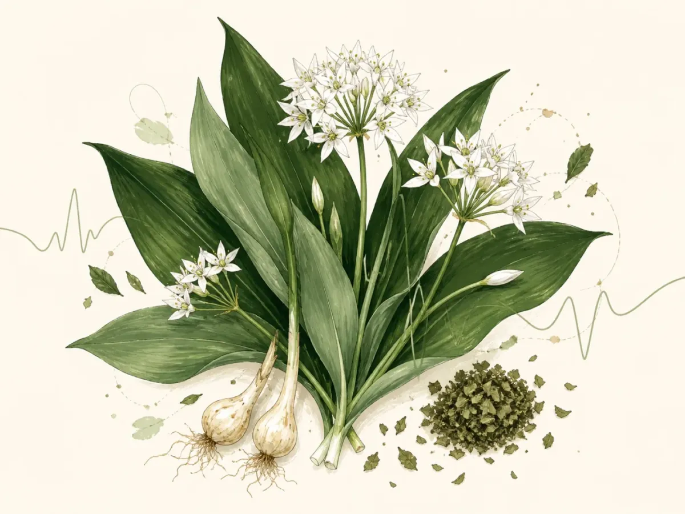

Visok pritisak najčešće nema nikakve simptome, pa većina ljudi godinama ne zna da ga ima. Simptomi kao što su jaka glavobolja, bol u grudima, vrtoglavica, mučnina, zamućen vid ili krvarenje iz nosa javljaju se obično tek kada je pritisak vrlo visok, oko 180/120 ili više. Jedini pouzdan način da saznate kakav vam je pritisak jeste merenje.

> Tekst je informativnog karaktera i ne zamenjuje savet lekara ili farmaceuta.

U nastavku su simptomi na koje treba obratiti pažnju, vrednosti koje se smatraju visokim, kako da pravilno izmerite pritisak kod kuće i kada je potrebna hitna pomoć.

## Da li visok krvni pritisak ima simptome

U većini slučajeva nema. Američki Centar za kontrolu bolesti ([CDC](https://www.cdc.gov/high-blood-pressure/about/index.html)) navodi da većina ljudi sa visokim pritiskom nema nikakve znake ni simptome. Zato je merenje jedini način da se pritisak otkrije.

Prema Svetskoj zdravstvenoj organizaciji (SZO), 2024. godine oko 1,4 milijarde odraslih između 30 i 79 godina imalo je visok pritisak. Oko 44% njih to nije znalo. Neotkriven pritisak godinama opterećuje srce, krvne sudove i bubrege. CDC navodi da povećava rizik od srčanog udara, srčane slabosti, moždanog udara i hronične bolesti bubrega.

### Visok pritisak na nervnoj bazi: simptomi ili stres?

Mnogi primete lupanje srca, nemir ili crvenilo u licu kada su pod stresom, pa pomisle da im je skočio pritisak. Ti znaci mogu da imaju mnogo uzroka. CDC dugotrajan stres navodi među faktorima rizika za visok pritisak, ali jedno visoko merenje u trenutku uzbuđenja nije dijagnoza. Zato britanski NICE pre postavljanja dijagnoze traži ponovljena merenja kod kuće ili 24-časovni holter pritiska.

## Simptomi vrlo visokog pritiska

Kada je pritisak vrlo visok, obično 180/120 ili više, simptomi mogu da se jave. [SZO](https://www.who.int/news-room/fact-sheets/detail/hypertension) navodi sledeće:

| Simptom | Šta uraditi |
|---|---|
| Jaka glavobolja | izmerite pritisak; ako je 180/120 ili više, javite se lekaru odmah |
| Bol u grudima | zovite hitnu pomoć na 194 |
| Otežano disanje | zovite hitnu pomoć na 194 |
| Vrtoglavica, mučnina, povraćanje | izmerite pritisak i javite se lekaru |
| Zamućen vid ili druge promene vida | zovite hitnu pomoć na 194 |
| Zbunjenost, uznemirenost | zovite hitnu pomoć na 194 ako je zbunjenost nova |
| Zujanje u ušima, krvarenje iz nosa | izmerite pritisak i javite se lekaru |
| Nepravilan rad srca | javite se lekaru odmah |

CDC tome dodaje bol u leđima, utrnulost, slabost i otežan govor. Ako se bilo koji od ovih znakova javi uz pritisak viši od 180/120, to je hitno stanje.

### Visok pritisak simptomi: glavobolja

Glavobolja je jedan od najčešće pominjanih simptoma, ali je nepouzdan znak. Ima mnogo uzroka, a umereno povišen pritisak je obično ne izaziva. Jaka glavobolja jeste na listi znakova vrlo visokog pritiska, pa ako je imate, prvo izmerite pritisak. Ako je vrednost visoka, ne čekajte da glavobolja prođe sama.

## Visok gornji i donji pritisak: koje vrednosti su visoke

Pritisak se zapisuje kao dva broja. Gornji (sistolni) je pritisak kada srce izbacuje krv, a donji (dijastolni) kada se srce opušta između otkucaja. Visok može da bude jedan od njih ili oba. I visok gornji i visok donji pritisak najčešće ne daju nikakve simptome.

Američke smernice, koje navode CDC i [MedlinePlus](https://medlineplus.gov/highbloodpressure.html), dele vrednosti ovako:

| Kategorija | Gornji (sistolni) i donji (dijastolni) pritisak |
|---|---|
| Normalan | gornji ispod 120 i donji ispod 80 |
| Povišen | gornji 120–129 i donji ispod 80 |
| Hipertenzija 1. stepena | gornji 130–139 ili donji 80–89 |
| Hipertenzija 2. stepena | gornji 140 ili više ili donji 90 ili više |
| Opasno visok | gornji iznad 180 i/ili donji iznad 120 |

SZO i britanski NICE kao granicu za hipertenziju u ordinaciji uzimaju 140/90 ili više. Za većinu ljudi cilj lečenja je ispod 140/90, a za one sa bolestima srca, šećernom bolešću ili bolešću bubrega ispod 130/80. Kod kućnog merenja granica je nešto niža: prema NICE, prosek od 135/85 ili više potvrđuje dijagnozu.

## Kako pravilno izmeriti pritisak kod kuće

Dijagnoza se ne postavlja na osnovu jednog merenja, već ponovljenih merenja u različitim danima. Ako lekar zatraži kućno merenje, postupak je sledeći. Prvi korak savetuje MedlinePlus, a ostale britanski [NICE](https://www.nice.org.uk/guidance/NG136/chapter/Recommendations):

1. Pre merenja sedite opušteno bar 5 minuta.
2. Izmerite pritisak dva puta zaredom, sedeći, u razmaku od najmanje jednog minuta.
3. Merite dva puta dnevno, ujutru i uveče.
4. Nastavite najmanje 4, a najbolje 7 dana.
5. Vrednosti iz prvog dana ne računajte, a od ostalih izračunajte prosek.
6. Zapišite rezultate i ponesite ih lekaru.

MedlinePlus savetuje da se javite lekaru ako kućna merenja i dalje pokazuju visok pritisak. Ako već pijete terapiju, redovno merenje pokazuje da li je pritisak pod kontrolom.

## Šta kažu dokazi: lekovi, način života i biljke

Visok pritisak se kontroliše promenama načina života i, kada je potrebno, lekovima. SZO savetuje više povrća i voća, manje soli, manje sedenja, bar 150 minuta umerene fizičke aktivnosti nedeljno, prestanak pušenja, ograničavanje alkohola i redovno uzimanje propisanih lekova.

**Ne prekidajte i ne menjajte terapiju bez lekara.** To što se osećate dobro ne znači da je pritisak normalan, jer visok pritisak najčešće ne boli.

Za biljke i dodatke dokazi su slabi:

- **Glog.** Evropska agencija za lekove ([EMA](https://www.ema.europa.eu/en/medicines/herbal/crataegi-folium-cum-flore)) list i cvet gloga navodi za ublažavanje prolaznih srčanih tegoba zbog nervoze, kao što je lupanje srca, i to tek kada lekar isključi ozbiljnu bolest. Visok pritisak nije na listi.
- **Minerali.** NICE izričito navodi da dodatke kalcijuma, magnezijuma ili kalijuma ne treba nuditi kao način za snižavanje pritiska.
- **Ostale biljke** iz čajeva za pritisak opisali smo u vodiču [čaj za pritisak: glog, hibiskus i druge biljke](/vodici/caj-za-pritisak/).

## Gotovi čajevi i kapsule: kako ih uporediti

U kategoriji [srce i pritisak](/srce-i-pritisak/) opisujemo nekoliko preparata. Nijedan ne snižava pritisak umesto leka. Ako ga birate kao dodatak uz terapiju, uporedite sastav, upozorenja i proizvođača, i pitajte lekara.

- [Hypertea](/ponude/rs/hypertea/) je rinfuz čaj sa listom i cvetom gloga (30%), hajdučkom travom, listom bele imele, korenom valerijane, listom breze i šipkom.
- [Hyper Caps](/ponude/rs/hyper-caps/) su kapsule sa suvim ekstraktom belog luka (250 mg), magnezijumom (75,38 mg, 20% NRV) i vitaminom E.
- [Hyper Drops](/ponude/rs/hyper-drops/) su kapi sa tečnim ekstraktom lista sremuša (divljeg belog luka) i sadrže alkohol.

### Kome nisu namenjeni

- **Osobe koje piju lekove.** Prema američkom centru NCCIH, neki biljni dodaci mogu da pojačaju ili oslabe dejstvo lekova. Lekaru i farmaceutu recite sve što uzimate, uključujući čajeve i kapsule.
- **Osobe sa srčanim tegobama bez dijagnoze.** EMA glog predviđa samo za odrasle i tek kada lekar isključi ozbiljnu bolest.
- **Trudnice i dojilje**, jer za ove biljke nema dovoljno podataka o bezbednosti.
- **Osobe koje ne smeju da unose alkohol**, kada su u pitanju kapi na bazi alkohola.

## Kada hitno lekaru

Prema CDC-u, pritisak viši od 180/120 je opasno visok. Ako uz to imate bol u grudima, otežano disanje, bol u leđima, utrnulost, slabost, promene vida ili otežan govor, odmah zovite hitnu pomoć na **194**. Ako je pritisak toliko visok, a nemate simptome, javite se lekaru istog dana.

Britanski NICE hitno upućivanje specijalisti predviđa kod pritiska od 180/120 ili više uz novu zbunjenost, bol u grudima, znake srčane slabosti, oštećenje bubrega ili promene na očnom dnu. Ne pokušavajte tada da pritisak spuštate čajem ili dodatnom dozom leka na svoju ruku. Lekaru se javite i ako kućna merenja više dana pokazuju 135/85 ili više.
